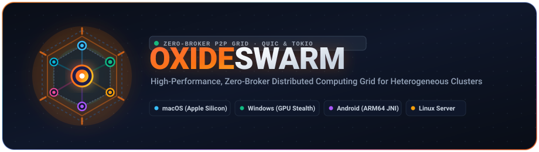

# OxideSwarm

<div align="center">

<p align="center">
  
</p>

**Zero-Broker Distributed Computing Grid for Heterogeneous Clusters**  
*Apple Silicon, Windows GPU PCs, Android phones and Linux boxes working as one personal compute grid*

[](https://www.rust-lang.org)
[](LICENSE)
[-lightgrey.svg?style=flat-square)](#8-verification--benchmarks)
[](https://iroh.computer)
[](docs/SECURITY.md)
[](#4-quickstart-guide)

</div>

---

## 1. Overview

**OxideSwarm** is a small distributed computing framework written in Rust. A **master** hands tasks (commands,
shell scripts, compile jobs, map/reduce chunks, GPU-class compute) to **workers** running on your own machines:
Apple Silicon MacBooks, Windows gaming PCs, Android phones and Linux servers.

* **Zero external message brokers**: Tokio actors, 4-byte length-delimited TCP streams and QUIC. No Redis, Kafka, RabbitMQ or ZooKeeper.
* **P2P NAT traversal (`iroh`)**: QUIC with DERP relay fallback connects machines on different networks without opening router ports or setting up a VPN (needs outbound Internet to the public n0 relays).
* **Shared-secret authentication & stream encryption**: only machines holding the same `cluster.secret` can join the grid or drive it, and workers only obey a master that proves it holds the secret. Authenticated TCP connections encrypt wire traffic post-handshake using ChaCha20-Poly1305 (`0x04`) with directional keys derived from the shared secret, while maintaining transparent backward compatibility for unauthenticated loopback dev/test runs. See [docs/SECURITY.md](docs/SECURITY.md).
* **Light background worker**: an idle worker consumes approximately 7–15 MB of working set RAM and virtually 0% CPU. The Windows runner starts headless, without console windows.
* **Quick role swapping and discovery**: `switch_role.sh` / `windows\switch_role.cmd` turn a machine into a master or a worker in a few seconds. Workers can find a master with `--master auto` (authenticated UDP beacon on `:8089`).
* **Decoupled 4-layer layout**: Rust core engine, Android JNI bridge, Agent Mesh coordination hub, cross-machine sync/benchmarks.
* **Process-tree lifecycle and bounded memory**: task process trees are terminated (`taskkill /F /T` / process groups), with LRU task eviction and stale-worker pruning on the master.
* **Task placement and a cluster check**: pin a task to an OS, an architecture, a tag or one worker (`submit --os`, `--arch`, `--require-tag`, `--worker`), send a script and input data with it, and verify a running cluster with `oxideswarm doctor`.

Documentation index and writing standard: [docs/README.md](docs/README.md). A macOS + Windows walk-through, verified end to end: [docs/guides/two-machine-cluster.md](docs/guides/two-machine-cluster.md).

---

## 2. Architecture & Cluster Topology

```text
                            ┌──────────────────────────────────────────────┐
                            │              OXIDESWARM MASTER               │
                            │      (MacBook M-Series OR Windows GPU PC)    │
                            │   Cluster TCP :8088 (secret-authenticated)   │
                            │   Dashboard   :8080 (token; loopback default)│
                            │      UDP LAN discovery beacon :8089          │
                            └───────────────▲───────────────▲──────────────┘
                                            │               │
                            Outbound TCP    │               │  Outbound TCP / QUIC
                           (Auto-Reconnect) │               │  (P2P ticket + secret)
                                            │               │
        ┌───────────────────────────────────┴─┐   ┌─────────┴─────────────────────────────┐
        │        MOBILE COMPUTE NODE          │   │        WINDOWS GPU COMPUTE NODE       │
        │   ARM64 Mobile Node (Galaxy/Pixel)  │   │     Windows Workstation / GPU Rig     │
        │       10 Cores Physical (ARM64)     │   │      (x86_64 + NVIDIA/AMD GPU)        │
        │  • Termux worker or JNI app         │   │  • headless background worker         │
        │  • Auto-cutoff on low battery (<15%)│   │  • Standby portal HTTP 307 redirect   │
        │  • Thermal throttling protection    │   │  • Anti-stuttering host protection    │
        └─────────────────────────────────────┘   └───────────────────────────────────────┘
```

---

## 3. Capabilities & Status

"Implemented + tests" indicates the functionality is implemented and covered by automated test suites in this repository. "Hardware-verified" indicates verification across physical platforms (macOS, Windows, Linux, Android).

| Category / Feature | What it is | Status |
| :--- | :--- | :--- |
| **1. Core grid & zero-broker** | Wire protocol with 4-byte length-delimited framing and dual-mode Serde; 1-byte format discriminator (`0x02` bincode, `0x01` tagged JSON, `0x7B` raw legacy JSON, `0x03` auth handshake, `0x04` AEAD encrypted). Formal `PROTOCOL_VERSION` and capability negotiation during handshake. | Implemented + tests |
| **2. Master coordinator & scheduler** | 8-state FSM (`Submitted` ➔ `Queued` ➔ `Scheduled` ➔ `Running` ➔ `Completed` / `Failed` / `Retrying` / `Cancelled`), batch-spread scheduling, fast-path recovery when a worker's socket drops (asserted below 200 ms in `tests/m2_challenger_2_stress.rs`), 10 s heartbeat reaper. | Implemented + tests |
| **3. GPU workload routing** | Tasks that require a GPU go only to workers that **advertise** one. A worker advertises a *real* GPU only if its binary was built with `--features gpu-wgpu` **and** the compute engine started on an adapter (looked for automatically at start-up unless `--no-gpu`; `--gpu` insists and prints a warning when that is not possible); a build without wgpu advertises none. `--simulate-gpu` advertises a labelled **simulated** GPU (a CPU multiplication, for testing) and is eligible as well; the master scheduler strictly prioritizes idle hardware GPU (`wgpu`) workers over simulated GPU (`--simulate-gpu`) workers for GPU tasks. | Implemented + tests |
| **4. Anti-stuttering backpressure** | Host CPU/RAM telemetry via `sysinfo`; above 85 % CPU (`--max-host-cpu-pct`) the master defers dispatches to that worker. | Implemented + tests |
| **5. In-memory Map/Reduce** | Chunking, built-in `word_count` / `line_count` kernels or your own mapper/reducer. | Implemented + tests |
| **6. Heterogeneous hardware** | macOS, Linux, Android (ARM64), and Windows (x86_64) supported. Windows binaries cross-compile (`build_windows_worker.sh`); Windows launchers run under PowerShell 5.1+ and cmd. | Hardware-verified |
| **7. Headless Windows worker** | [windows/run_worker_silent.vbs](windows/run_worker_silent.vbs) starts a worker without console windows (it needs the master's `cluster.secret` first); [windows/status_worker.cmd](windows/status_worker.cmd) shows the real working set; [windows/stop_worker.cmd](windows/stop_worker.cmd) stops only the process it started. | Implemented + launcher tests |
| **8. Role swapping** | [switch_role.sh](switch_role.sh) (macOS/Linux) and [windows/switch_role.cmd](windows/switch_role.cmd): stop whatever this launcher started, start the new role, wait until it is up (the macOS/Linux script also checks that a worker registered) and print the next steps. Takes a few seconds. There is **no automatic failover or election**; a person (or script) decides. | Implemented |
| **9. Master discovery & fallback** | Multi-tier authenticated coordinator discovery: Tier 1 LAN UDP beacon on `:8089` (`--master auto`), Tier 2 authenticated HTTP probe (`GET /api/discovery/probe?nonce=<hex>`), Tier 3 signed rendezvous registry (`--rendezvous <URL>` / `OXIDESWARM_RENDEZVOUS`) for cross-subnet and AP-isolated environments. Standby portal on `:8080` HTTP 307 redirect remains supported. Design: [docs/design/0004-mcp-and-discovery.md](docs/design/0004-mcp-and-discovery.md). | Implemented + tests |
| **10. Web dashboard** | Axum server serving the SPA `crates/master/src/dashboard.html` (no CDN) plus REST, `/ws` and SSE. Loopback by default; reachable from phones/LAN only when you pass `--web-ui-addr 0.0.0.0:8080` (or `switch_role.sh master --dashboard-lan`); every request off the dev bypass needs the token printed by `oxideswarm secret show --dashboard-token`. | Implemented + tests |
| **11. Workflow modes (`ox-mode`)** | `test` (quick / lint / flaky / full), `dev` (fast check / local cluster / watch), `doc`, `research` (profile / bench / report). | Implemented + tests |
| **12. Benchmarks & chaos** | Empirical baseline performance demonstrates parallel SHA-256 throughput of 341.3 MB/s (1.55x scaling across two nodes) and mid-task worker failure detection within 319 ms. Reproduce telemetry: [run_cluster_benchmark.sh](run_cluster_benchmark.sh) (two local worker processes, or a phone with `--adb-id`) and [run_chaos_test.sh](run_chaos_test.sh) (starts its own cluster, kills a worker that holds running tasks, verifies re-execution). | Implemented + scripts |
| **13. Zero-copy I/O & QUIC multiplexing** | `bytes::Bytes` payloads; two iroh streams per connection (`STREAM_CONTROL = 0x01`, `STREAM_DATA = 0x02`) so bulk data cannot block heartbeats; scheduler micro-batching. | Implemented + tests |
| **14. Mid-task checkpointing** | `WorkerMessage::Checkpoint` / `MasterMessage::AssignTaskWithCheckpoint`; reassigned workers resume from the last delta. | Implemented + tests |
| **15. GPU compute (`wgpu`)** | `cargo build --release --bin oxideswarm --features gpu-wgpu` gives a worker that multiplies matrices on the machine's GPU (Metal on macOS, Vulkan / DirectX 12 on Windows and Linux; discrete GPU prioritized over integrated), checks the product against a sampled CPU recomputation and reports `Status: VERIFIED_OK` only if that check passed. A `GpuCompute` task is a **seeded `simulated_matrix_dim` x `simulated_matrix_dim` GEMM** tiled by `work_group_size`. A GPU error, device loss or driver panic fails that task with an explicit message and the engine is rebuilt for the next one. A worker never runs a real-GPU task on the CPU: the CPU path is the labelled `--simulate-gpu` test mode only. Run benchmark with `cargo run --release -p rusty_grid_worker --features gpu-wgpu --example gemm_bench -- 1024`. | Implemented + tests (verified on Metal & Vulkan) |
| **16. Security** | Shared-secret mutual authentication on the cluster port (TCP and P2P) and on the UDP beacon; authenticated TCP stream encryption via ChaCha20-Poly1305 (`0x04`) with directional keys derived from `cluster.secret`; token-protected, same-origin dashboard; agent-mesh hub token. See [docs/SECURITY.md](docs/SECURITY.md). | Implemented + tests |
| **17. Agent Mesh ↔ Grid bridge** | `AgentGridBridge` lets `agent-mesh hub` run a Master Grid of its own (`--grid-master <ADDR>` starts an embedded master; off loopback it needs a cluster secret or `--insecure`) and routes `grid_compute` / `grid_compile` / `grid_submit` / `grid_status` envelopes to it. When unconfigured, returns `ERR_BRIDGE_NOT_CONFIGURED`. | Implemented + tests |
| **18. Task placement & cluster check** | Workers advertise `os:` and `arch:` tags plus user tags (`worker --tag`); `submit --os`, `--arch`, `--worker`, `--require-tag` pin a task through `require:` task tags, so the wire format is unchanged. `submit --stdin-file`, `--script-file`, `--interpreter` and `--env` send input with the task; `--matrix-dim` sizes a GPU task. `oxideswarm doctor` checks connection, every worker, process start-up, every GPU and spreading. Design: [docs/design/0001-two-node-readiness.md](docs/design/0001-two-node-readiness.md). | Implemented + tests |
| **19. Mobile coordination & battery governance** | Multi-tier throttling $C_{\text{eff}} = \min(C_{\text{bat}}, C_{\text{therm}})$, RRC adaptive keepalive (10s/25s/60s), 5-rule refusal matrix, authenticated candidate score election $S_{\text{auth}}$, cryptographic lease tickets, and pre-sleep evacuation. Design: [docs/design/0002-mobile-coordination.md](docs/design/0002-mobile-coordination.md). | Implemented + tests |
| **20. Distributed file staging** | Content-addressed file transfer with SHA-256 worker caching, atomic staging, sandbox execution, and artifact collection (`submit --file`, `--output`, `--output-dir`). Design: [docs/design/0003-distributed-file-staging.md](docs/design/0003-distributed-file-staging.md). | Implemented + tests |
| **21. Model Context Protocol (MCP) server** | Standard JSON-RPC 2.0 stdio MCP server (`oxideswarm mcp`) exposing 5 core cluster tools (`oxideswarm_status`, `oxideswarm_workers`, `oxideswarm_submit`, `oxideswarm_task_status`, `oxideswarm_cancel`) to LLM coding agents with strict stdout hygiene. Design: [docs/design/0004-mcp-and-discovery.md](docs/design/0004-mcp-and-discovery.md). | Implemented + tests |

---

### Known Limitations & Roadmap

| # | Limitation / Goal | Status | Technical details |
|---|---|---|---|
| **1** | Encrypted TCP stream transport | Completed | Authenticated TCP connections negotiate directional ChaCha20-Poly1305 AEAD keys derived from `cluster.secret` (`0x04` wire format). Transparent loopback fallback is maintained for unauthenticated dev/test runs. |
| **2** | Mobile coordination & automatic failover | Completed | Dynamic task throttling $C_{\text{eff}} = \min(C_{\text{bat}}, C_{\text{therm}})$, RRC adaptive keepalive (10s/25s/60s), 5-rule refusal matrix, authenticated candidate score election $S_{\text{auth}}$, cryptographic lease tickets, and pre-sleep task evacuation. Documented in [docs/design/0002-mobile-coordination.md](docs/design/0002-mobile-coordination.md). |
| **3** | MCP server for AI agents | Completed | Standard JSON-RPC 2.0 stdio Model Context Protocol (MCP) server (`oxideswarm mcp`) exposing `oxideswarm_status`, `oxideswarm_workers`, `oxideswarm_submit`, `oxideswarm_task_status`, and `oxideswarm_cancel` tools to LLM coding agents with strict stdout transport hygiene. Documented in [docs/design/0004-mcp-and-discovery.md](docs/design/0004-mcp-and-discovery.md). |
| **4** | Real GPU scheduler preference | Completed | Master scheduler strictly prioritizes idle hardware GPU (`wgpu`) workers over simulated GPU (`--simulate-gpu`) workers for `requires_gpu` tasks, dispatching to simulated workers only when no hardware GPU is available. |
| **5** | Android app cluster secret auth | Completed | `crates/android_bridge` exposes `nativeSetClusterSecret` and `nativeStartWorkerWithSecret` JNI exports, and Kotlin `WorkerEngine` accepts `clusterSecret` to authenticate against protected masters. |
| **6** | Distributed file staging | Completed | Content-addressed distributed file staging (`submit --file <PATH>`, `--output <PATH>`, `--output-dir <DIR>`) with SHA-256 worker caching, atomic hardlinks/copies into task sandboxes, and output artifact collection. Documented in [docs/design/0003-distributed-file-staging.md](docs/design/0003-distributed-file-staging.md). |
| **7** | UDP discovery on isolated subnets | Completed | 3-tier discovery fallback: Tier 1 LAN UDP beacon (:8089), Tier 2 authenticated HTTP probe (`GET /api/discovery/probe?nonce=<hex>`), Tier 3 signed rendezvous registry (`--rendezvous <URL>` / `OXIDESWARM_RENDEZVOUS`) for cross-subnet and AP isolation environments. Documented in [docs/design/0004-mcp-and-discovery.md](docs/design/0004-mcp-and-discovery.md). |
| **8** | Mid-task checkpointing | Done | See feature 14. |
| **9** | OS child process containment | Hardened | Spawned task child processes are atomically bound to OS-level containment handles: Windows Job Objects (`JOB_OBJECT_LIMIT_KILL_ON_JOB_CLOSE` with `CREATE_SUSPENDED`) and Linux `PR_SET_PDEATHSIG(SIGKILL)` guarantee child tree cleanup on worker termination. |
| **10** | Protocol version & capability negotiation | Completed | Formal `PROTOCOL_VERSION` and `ProtocolCapabilities` handshake exchange prevents frame drops and enables graceful capability mismatch handling across master, worker, and CLI. |

---

## 4. Quickstart Guide

Ports: **8088** is the cluster port (workers and `submit` / `status` talk to it), **8080** is the dashboard
(never a valid `--master` target), **8089/udp** is discovery. Details: [docs/SECURITY.md](docs/SECURITY.md#4-what-each-port-exposes).

### Step 0: Build

```bash
cargo build --release --bin oxideswarm --bin rusty-grid     # the two names are the same program
# Add --features gpu-wgpu on a machine whose GPU should do work (Apple Silicon Mac, Windows GPU PC);
# without it the worker cannot use the GPU and advertises none:
cargo build --release --bin oxideswarm --features gpu-wgpu
```

### Step 1: Start the master and share the secret

```bash
# macOS / Linux: cluster port 8088 on every interface, dashboard on this machine only, plus a local worker
./switch_role.sh master
./switch_role.sh master --p2p              # also publish a P2P ticket for machines on other networks (step D)
./switch_role.sh master --dashboard-lan    # also open the dashboard (:8080) to phones / the LAN
./switch_role.sh master --no-worker        # master only

# the same by hand
./target/release/oxideswarm master --listen 0.0.0.0:8088
./target/release/oxideswarm master --listen 0.0.0.0:8088 --p2p --p2p-ticket-file ~/.oxideswarm/master_ticket.txt
```

Windows master: `windows\switch_role.cmd master [--p2p] [--lan-dashboard]`.

The first start of a master that other machines can reach creates **`~/.oxideswarm/cluster.secret`** and prints
where it is. **Copy that file to every machine that should join** (workers and anyone running `submit`), over a
channel you trust, for example:

```bash
scp user@master:~/.oxideswarm/cluster.secret ~/.oxideswarm/cluster.secret && chmod 600 ~/.oxideswarm/cluster.secret
```

(Windows: `%USERPROFILE%\.oxideswarm\cluster.secret`; a USB stick works too. Never chat, e-mail or cloud-synced folders.)
A master bound to loopback only (plain `oxideswarm master`) needs no secret. The dashboard token is
`oxideswarm secret show --dashboard-token`. More: [docs/SECURITY.md](docs/SECURITY.md).

### Step 2: Connect compute workers

For a Mac and a Windows PC, follow [docs/guides/two-machine-cluster.md](docs/guides/two-machine-cluster.md): it covers
the link (Wi-Fi, Ethernet, P2P), both roles and the check with `oxideswarm doctor`.

#### A. Windows GPU rig (headless background worker)
Put the master's `cluster.secret` into `%USERPROFILE%\.oxideswarm\`, then in the `windows\` folder:
* Double-click [`windows/run_worker_silent.vbs`](windows/run_worker_silent.vbs) (looks for the master with `auto`), or
* run `windows\switch_role.cmd worker <MASTER_IP>:8088`, or `windows\start_worker.cmd <MASTER_IP>:8088`
  (the worker uses the GPU only if `rusty-grid.exe` was built with `--features gpu-wgpu`, e.g.
  `./build_windows_worker.sh --gpu`; it then finds the card itself and prints the adapter at start-up, and
  without that feature it says so and advertises **no** GPU, also with `--gpu`), or
* install a service that starts at boot: `windows\install_service.cmd <MASTER_IP>:8088 C:\path\to\cluster.secret`
  (runs as the low-privilege virtual account `NT SERVICE\OxideSwarmWorker`, not SYSTEM; see
  [packaging/windows/README.md](packaging/windows/README.md)).

#### B. Android phone (Samsung Galaxy / Pixel)
* **Termux worker (works with the secret today)**: [`packaging/android/termux`](packaging/android/README.md): run
  `install_termux_daemon.sh`, put the master's cluster address (`<MASTER_IP>:8088`) and the copied secret in place,
  then `start_worker.sh --daemon`.
* **Android app (JNI)**: build `liboxideworker.so` first with `packaging/android/build_android_jni.sh --release`
  and then the APK ([guide](packaging/android/README.md)). Supports native cluster secret configuration via
  `nativeSetClusterSecret` and `nativeStartWorkerWithSecret`.
* **Dashboard from the phone**: start the master with `--dashboard-lan`, open `http://<MASTER_IP>:8080` and log in with
  the token from `oxideswarm secret show --dashboard-token`. The page's **"Scan Master"** button probes the current
  host, hosts saved in the browser and hosts the master lists in `/api/status`; it does not scan your subnet.

#### C. Instant role swapping (promote Windows to master)
* On the Windows PC: `windows\switch_role.cmd master` (or menu option `1`).
* On the Mac: `./switch_role.sh worker <WINDOWS_IP>:8088` (or menu option `2`).
Both machines need the same `cluster.secret` first. Nothing else is killed: the launchers stop only the processes
they started (PID files in `~/.oxideswarm/run`).

#### D. Remote WAN Connection (Cross-Network / Internet — requires Ticket AND Secret)
When two machines are on different networks (e.g., laptop on remote Wi-Fi, desktop compute node at home/office):
1. **On the Master coordinator**, enable P2P: `./switch_role.sh master --p2p` (or `oxideswarm master --listen 0.0.0.0:8088 --p2p --p2p-ticket-file ~/.oxideswarm/master_ticket.txt`). The master requires outbound Internet access to reach public Iroh (n0) DERP relays.
   - The connection ticket is written to `~/.oxideswarm/master_ticket.txt`, printed in console output, or copied via the **"📋 Copy P2P Ticket"** button in the Web Dashboard.
   - The ticket remains deterministic across restarts if `~/.oxideswarm/master_key.bin` is preserved and relays are reachable during startup.
2. **Copy the cluster secret** `~/.oxideswarm/cluster.secret` from the Master to the worker machine via `scp`, SSH, or physical USB drive. The P2P ticket provides address routing only and does not establish authorization; workers refuse pairing if the secret is missing (unless `--insecure` is explicitly passed).
3. **On the Worker machine**:
   - **macOS / Linux**: Run `./connect_remote.sh "<TICKET>" --secret-file /path/to/cluster.secret` (or execute without arguments to paste interactively). The ticket is persisted to `~/.oxideswarm/remote-worker.toml` (mode 0600) without modifying default configs. Pass `--service` to install a user-level LaunchDaemon on macOS.
   - **Windows**: Double-click [`connect_remote.cmd`](connect_remote.cmd) and paste the ticket when prompted (avoid passing JSON via command-line arguments to prevent shell character stripping). The script requests elevation, installs the `OxideSwarmWorker` service under the virtual account `NT SERVICE\OxideSwarmWorker`, and awaits registration confirmation.
4. **Automated Path Routing**:
   - Nodes attempt UDP hole-punching for direct zero-broker connectivity (`🟢 Direct P2P | <RTT>ms`).
   - If UDP traffic is restricted by carrier CGNAT or firewalls, traffic automatically routes through encrypted HTTPS relays (`🟣 DERP Relay | <RTT>ms`).
   - Comparative performance benchmarks are documented in the [Interconnect Benchmark Report](benchmarks/interconnect/COMPARATIVE_INTERCONNECT_BENCHMARK.md).
   - P2P communication is encrypted via TLS by Iroh, in addition to HMAC-SHA256 cluster secret verification.

#### E. Cross-Machine Shared-Folder Probe (`scripts/sync_network`)
A lightweight utility for two machines sharing a cloud-synchronized folder (e.g., Google Drive, OneDrive, or local NFS/SMB share) to verify peer visibility:
- **Role Assignment (SERVER / CLIENT)**: Mediated via ephemeral `claim_<platform>.json` tokens in the shared directory (claims older than 180 seconds are invalidated).
- **HTTP Ping on Port 8085**: Direct reachability check between hosts; writes `ping_success.txt` upon verification or generates detailed troubleshooting logs.
- **Process & Secret Isolation**: The probe does not interact with the Rust compute grid (ports 8088, 8080, 8089) and never exchanges tickets or secrets. Secrets must never be stored in cloud-synced storage.
- For complete details, see [scripts/sync_network/README.md](scripts/sync_network/README.md).

### Troubleshooting

Start with `oxideswarm doctor --expect-workers <N>` on any machine that holds the secret: it names the check that fails.

| Symptom | Likely cause and fix |
| :--- | :--- |
| `submit` warns that no connected worker matches the placement constraints | `--os`, `--arch`, `--worker` or `--require-tag` names something no connected worker has. The task waits in the queue; start that worker or fix the constraint (`workers --json` lists the `os:`, `arch:`, `id:` and user tags). |
| `Authentication required: ...` / `refusing to connect ... without a cluster secret` (exit code 6) | This machine has no (matching) secret. Copy `~/.oxideswarm/cluster.secret` from the master, or pass `--secret-file PATH`. `--insecure` skips the check and is only for networks you fully control. |
| `Authentication failed` | The secrets differ, e.g. the master ran `secret generate --force`. Copy the master's file again and restart the worker. |
| Worker logs `Connection refused` or times out | Wrong port (use the **cluster** port 8088, not the dashboard's 8080); the master listens on loopback only (the default; start it with `--listen 0.0.0.0:8088`); a firewall blocks 8088. |
| A worker started with `--master HOST:8088` never registers and logs P2P or `Invalid P2P ticket` errors | A `p2p_ticket` sits in the config file the CLI auto-loads (`RUSTY_GRID_CONFIG`, `./rusty-grid.toml`, `~/.oxideswarm/rusty-grid.toml`) and may take precedence over `--master`. Remove that line. `connect_remote.sh` now writes `remote-worker.toml` instead and never touches `rusty-grid.toml`. |
| `--master auto` finds nothing | The UDP beacon (`:8089`) is not routed (Wi-Fi client isolation, another subnet, VPN) or the beacon's secret does not match. Use `HOST:8088`. |
| Dashboard answers `401` or shows a login prompt | Paste the token from `oxideswarm secret show --dashboard-token` (on the master). A phone can only reach the dashboard if the master was started with `--web-ui-addr 0.0.0.0:8080` / `--dashboard-lan`. |
| `Address already in use` on 8088 | Another master, or the agent-mesh hub (it also defaults to 8088). Stop it or choose another port (`OXIDESWARM_CLUSTER_PORT` for the launchers, `--listen` by hand). |
| P2P pairing hangs | The master needs `--p2p` and Internet access to the public relays; the pairing machine needs the ticket **and** the secret. |
| `GPU tasks never reach the GPU` / `worker starts with "no GPU is advertised"` | The binary was built without the wgpu engine. Rebuild with `cargo build --release --bin oxideswarm --features gpu-wgpu` (Windows cross-build: `./build_windows_worker.sh --gpu`); the worker prints `GPU compute enabled on <adapter>` at start-up when it works (see Capabilities #15). `--gpu` on a binary without the engine is ignored with a warning. |
| A GPU task fails with `GPU unavailable` / `GPU device error` | The worker advertised a GPU but the engine could not use it (no adapter, driver reset). The task failed instead of running on the CPU; the next task rebuilds the engine. Check the worker log. |

---

## 5. CLI Reference & Workflow Modes (`ox-mode`)

OxideSwarm includes a unified CLI management tool:

```bash
# Launch the interactive terminal UI (TUI) menu:
./ox-mode

# Code Quality & Testing Mode (Linting + Flaky test detection):
./ox-mode test lint
./ox-mode test flaky --iterations 5

# Development Mode (Live-reload file watcher):
./ox-mode dev watch

# Research & Performance Profiling Mode:
./ox-mode research bench
./ox-mode research distributed
```

### Direct CLI commands (`oxideswarm` / `rusty-grid`)

`oxideswarm` and `rusty-grid` are the same program (`rusty-grid` is the older name; use either). Every command
accepts `--help`. Clients and workers read the cluster secret from `--secret-file`, `OXIDESWARM_SECRET_FILE`,
or `~/.oxideswarm/cluster.secret`.

```bash
# Master. Default listen is 127.0.0.1:8088 (this machine only); other machines need 0.0.0.0:8088.
./target/release/oxideswarm master --listen 0.0.0.0:8088
# Dashboard on the LAN as well (explicit; default is loopback):
./target/release/oxideswarm master --listen 0.0.0.0:8088 --web-ui-addr 0.0.0.0:8080
# Register with Tier 3 HTTP rendezvous registry:
./target/release/oxideswarm master --listen 0.0.0.0:8088 --rendezvous http://rendezvous.example.com:8080

# Worker: --master takes the CLUSTER port (default 127.0.0.1:8088; a bare host gets :8088; 'auto' = LAN discovery)
./target/release/oxideswarm worker --master 192.168.1.100:8088
./target/release/oxideswarm worker --master 192.168.1.100:8088                  # a --features gpu-wgpu build finds and uses the GPU itself
./target/release/oxideswarm worker --master 192.168.1.100:8088 --gpu            # insist: warns and advertises no GPU if there is none / no wgpu
./target/release/oxideswarm worker --master 192.168.1.100:8088 --no-gpu         # keep this machine's GPU out of the grid
./target/release/oxideswarm worker --master auto --rendezvous http://rendezvous.example.com:8080  # discover via Tier 3 fallback

# Submit work (--command is the executable, arguments follow after --; the file must exist on the worker)
./target/release/oxideswarm submit --master 127.0.0.1:8088 --command echo --wait -- hello
./target/release/oxideswarm submit --master 127.0.0.1:8088 --command sha256sum --wait -- /path/present/on/the/worker
./target/release/oxideswarm submit --master 127.0.0.1:8088 --type gpu --gpu --wait   # routed to a worker that advertises a GPU

# Distributed file staging (stage input files to worker sandbox; collect output artifacts to coordinator)
./target/release/oxideswarm submit --file input.dat --output results.csv --command process_data -- --input input.dat --output results.csv
./target/release/oxideswarm submit --file weights.bin --output-dir outputs/ --command run_eval -- --weights weights.bin --outdir outputs/

# Worker with user tags (matched by `submit --require-tag`); os:/arch: tags are added automatically
./target/release/oxideswarm worker --master <MASTER_IP>:8088 --tag laptop --tag office
# A second worker on the same machine: give it its own name and no standby portal on :8080
./target/release/oxideswarm worker --master <MASTER_IP>:8088 --name <NAME>-2 --no-portal

# Pin a task to an OS, an architecture, a tag or one worker (a name, or an id from `workers --json`)
./target/release/oxideswarm submit --os windows --wait --command cmd -- /C ver
./target/release/oxideswarm submit --worker <WORKER_NAME> --wait -- uname -a
./target/release/oxideswarm submit --require-tag laptop --arch x86_64 --wait -- hostname

# Send input with the task (each file at most 32 MiB): a script, standard input, environment variables
./target/release/oxideswarm submit --type shell --interpreter python3 --script-file job.py --wait
./target/release/oxideswarm submit --stdin-file data.txt --env MODE=fast --wait --command wc -- -l

# GPU task of a chosen size (default 64; up to 8192 on a real GPU, 2048 on the simulated one)
./target/release/oxideswarm submit --type gpu --matrix-dim 2048 --wait

# Inspect the grid
./target/release/oxideswarm workers --master 127.0.0.1:8088
./target/release/oxideswarm status --master 127.0.0.1:8088 --json
./target/release/oxideswarm mapreduce --master 127.0.0.1:8088 --input data.txt --mapper word_count --reducer sum

# Model Context Protocol (MCP) stdio server for AI coding assistants
./target/release/oxideswarm mcp --master 127.0.0.1:8088

# Check the whole cluster: every worker, process start-up, every GPU, spreading
# (exit code 0 = all checks passed, 1 = a check failed, 6 = authentication failed)
./target/release/oxideswarm doctor --expect-workers 2
./target/release/oxideswarm doctor --json --skip-gpu

# Secret management
./target/release/oxideswarm secret generate
./target/release/oxideswarm secret show --dashboard-token
```

Exit code `6` means authentication failed. Remote or auto-discovered masters are refused without a secret unless
you pass `--insecure`.

### Network Port Topology

| Port | Protocol | Component | Role & Port Conflict Guidance |
| :--- | :--- | :--- | :--- |
| **8088** | TCP | Master Grid Coordinator | Primary cluster communication port for worker node registration, heartbeat exchanges, task distribution, and CLI client requests (`submit`, `status`, `workers`, `mapreduce`). Protected by mutual HMAC-SHA256 handshake (`cluster_auth`). |
| **8088** | TCP (WS/HTTP) | Agent Mesh Relay Hub | Default listener for `agent-mesh hub`. **Critical Port Conflict:** The default binding `127.0.0.1:8088` collides with the Master Grid port when co-located on the same physical host. Operators MUST bind the Hub to alternate ports (e.g. `--listen 0.0.0.0:8090`) when co-locating services. |
| **8080** | HTTP | Master Dashboard & Worker Standby | Embedded Axum web server providing cluster telemetry, live status graphs, task submission, and WebSocket streams (`/ws`). Bound to loopback by default; requires explicit `--web-ui-addr 0.0.0.0:8080` to expose across LAN. Protected by RBAC bearer tokens or derived cluster admin token (`oxs1-dashboard-admin`). When a standalone worker runs without a master, it binds `0.0.0.0:8080` to serve an HTTP 307 redirect to the discovered Master (`worker --no-portal` turns that off). |
| **8089** | UDP | Master Discovery Beacon | Master broadcasts cluster address and optional dashboard URL to subnet broadcast (`255.255.255.255:8089`). When a cluster secret is present, beacon payloads include HMAC-SHA256 signatures to prevent rogue discovery spoofing. Workers with `--master auto` listen here. |
| **8085** | TCP (HTTP) | Cross-Machine Sync Probe | Standalone reachability probe used strictly by `scripts/sync_network` to verify LAN connectivity between nodes using cloud-shared mailboxes. Completely independent of the Rust grid runtime. |

### Environment Variables Inventory

OxideSwarm resolves configuration through a 4-tier hierarchical engine:
$$\text{CLI Flags} > \text{Environment Variables} > \text{Configuration File (rusty-grid.toml)} > \text{Defaults}$$

#### Tier A: Core Authentication & Configuration Engine
| Variable | Component | Purpose |
| :--- | :--- | :--- |
| `OXIDESWARM_SECRET` | Global | 64-character hex cluster secret for mutual node authentication |
| `OXIDESWARM_SECRET_FILE` | Global | File path pointing to cluster secret (mode 0600; preferred over inline hex) |
| `RUSTY_GRID_CONFIG` | Global | Path to TOML or JSON configuration file |

#### Tier B: Master Coordinator & Scheduling
| Variable | Component | Purpose |
| :--- | :--- | :--- |
| `RUSTY_GRID_MASTER_LISTEN` | Master | Primary listen socket address for grid coordinator |
| `RUSTY_GRID_LISTEN` | Master | Fallback alias for coordinator listen address |
| `RUSTY_GRID_PORT_FILE` | Master | File path where bound TCP port number is written |
| `RUSTY_GRID_HEARTBEAT_INTERVAL_SECS` | Master | Heartbeat interval advertised to workers |
| `RUSTY_GRID_HEARTBEAT_TIMEOUT_SECS` | Master | Liveness timeout before worker is marked dead |
| `RUSTY_GRID_REAPER_INTERVAL_SECS` | Master | Frequency of dead-worker reaper evaluation sweeps |
| `RUSTY_GRID_MAX_HOST_CPU_PCT` | Master | Host CPU % threshold for anti-stuttering backpressure |
| `RUSTY_GRID_PRESERVE_GPU` | Master | Flag to preserve GPU workers for GPU-specific workloads |
| `RUSTY_GRID_P2P` | Master | Enables Iroh QUIC/DERP P2P WAN endpoint |
| `RUSTY_GRID_P2P_TICKET_FILE` | Master | File path where generated P2P ticket string is written |
| `RUSTY_GRID_P2P_KEY_FILE` | Master | File path where master P2P identity key is persisted |
| `RUSTY_GRID_EPHEMERAL_KEY` | Master | Forces generation of ephemeral P2P key without file persistence |
| `RUSTY_GRID_WIRE_CODEC` | Master | Serialization wire codec (`bincode` or `json`) |
| `RUSTY_GRID_DEFAULT_RETRY_MAX` | Master | Default task retry ceiling on failure |
| `RUSTY_GRID_MAX_RETRIES` | Master | Secondary alias for default task retry ceiling |
| `RUSTY_GRID_MAX_RETAINED_TASKS` | Master | Maximum count of finished tasks retained in memory |
| `RUSTY_GRID_MAX_RETAINED_MB` | Master | Maximum megabytes of finished task payloads retained |
| `RUSTY_GRID_MAPREDUCE_PARALLELISM` | Master | Maximum concurrent in-flight map/reduce chunk tasks |
| `RUSTY_GRID_MAX_CONNECTIONS` | Master | Maximum concurrent TCP connections allowed on grid port |
| `RUSTY_GRID_MAX_PENDING_HANDSHAKES` | Master | Maximum connections permitted in pre-auth handshake state |
| `RUSTY_GRID_INSECURE` | Master | Allows coordinator to bind non-loopback without requiring cluster secret |
| `RUSTY_GRID_DASHBOARD_PORT` | Master | HTTP listener port for embedded web dashboard |
| `OXIDE_SWARM_DASHBOARD_PORT` | Master | Alternative alias for dashboard HTTP port |
| `RUSTY_GRID_DASHBOARD_PORT_FILE` | Master | File path where bound dashboard HTTP port is written |
| `OXIDE_SWARM_DASHBOARD_PORT_FILE` | Master | Alternative alias for dashboard port file |
| `RUSTY_GRID_DISABLE_WEB_UI` | Master | Disables embedding of Axum web dashboard server |
| `RUSTY_GRID_ENABLE_WEB_UI` | Master | Explicit override to force-enable web dashboard server |
| `RUSTY_GRID_DISABLE_DISCOVERY` | Master | Disables UDP discovery beacon listener/broadcaster |
| `OXIDESWARM_RENDEZVOUS` | Master | HTTP rendezvous registry URL for publishing coordinator address lease |
| `OXIDE_DEV_MODE` | Master | Enables dashboard local development bypass on loopback interfaces |

#### Tier C: Worker Node Engine
| Variable | Component | Purpose |
| :--- | :--- | :--- |
| `RUSTY_GRID_MASTER_ADDR` | Worker | Target Master grid address (`HOST:PORT`) |
| `RUSTY_GRID_MASTER` | Worker | Secondary alias for Master grid address |
| `OXIDESWARM_RENDEZVOUS` | Worker | HTTP rendezvous registry URL for discovering active master address |
| `RUSTY_GRID_P2P_TICKET` | Worker | Iroh P2P connection ticket for remote NAT traversal |
| `RUSTY_GRID_WORKER_NAME` | Worker | Advertised worker name (persists ID to `~/.oxideswarm/worker_id.<NAME>`) |
| `RUSTY_GRID_NAME` | Worker | Secondary alias for worker name |
| `RUSTY_GRID_WORKER_TAGS` | Worker | Comma-separated user tags advertised to the master (`--tag`; matched by `submit --require-tag`) |
| `RUSTY_GRID_WORKER_ID_FILE` | Worker | Explicit file path where worker node UUID is persisted |
| `RUSTY_GRID_CORES` | Worker | Advertised CPU core count override |
| `RUSTY_GRID_CPU_CORES` | Worker | Secondary alias for advertised CPU core count |
| `RUSTY_GRID_RAM_MB` | Worker | Advertised RAM in Megabytes override |
| `RUSTY_GRID_OVERRIDE_RAM_MB` | Worker | Secondary alias for advertised RAM override |
| `RUSTY_GRID_GPU` | Worker | Request real GPU activation |
| `RUSTY_GRID_ENABLE_GPU` | Worker | Secondary alias to request GPU activation |
| `RUSTY_GRID_NO_GPU` | Worker | Forcefully suppresses GPU discovery and advertising |
| `RUSTY_GRID_SIMULATE_GPU` | Worker | Advertises simulated GPU executing GEMM on CPU SIMD fallback |
| `RUSTY_GRID_GPU_NAME` | Worker | Custom advertised GPU model string |
| `RUSTY_GRID_ENABLE_PHYSICAL_GPU` | Worker | Force-enables hardware wgpu engine initialization without `--gpu` |
| `RUSTY_GRID_REQUIRE_GPU` | Worker | In tests, asserts that failure to initialize physical GPU is fatal |
| `RUSTY_GRID_MAX_CONCURRENCY` | Worker | Maximum simultaneous concurrent tasks executed |
| `RUSTY_GRID_MAX_CONCURRENT_TASKS` | Worker | Secondary alias for maximum concurrent tasks |
| `RUSTY_GRID_SANDBOX_BASE_DIR` | Worker | Base filesystem directory for task execution sandboxes |
| `RUSTY_GRID_TASK_PRIORITY` | Worker | Process scheduling priority: `normal`, `below-normal`, or `idle` |
| `RUSTY_GRID_KEEP_SANDBOXES` | Worker | Retains task working directories upon completion |
| `RUSTY_GRID_NO_PORTAL` | Worker | Leaves out the standby portal on `0.0.0.0:8080` (`--no-portal`), e.g. for a second worker on one machine |

#### Tier D: Task Child Process Injection Environment
| Variable | Component | Purpose |
| :--- | :--- | :--- |
| `RUSTY_GRID_TASK_ID` | Task Runner | UUIDv4 string of the currently executing task (injected into child env) |
| `RUSTY_GRID_WORKER_ID` | Task Runner | UUIDv4 string of the assigned worker node |
| `RUSTY_GRID_SANDBOX_DIR` | Task Runner | Absolute path to the isolated scratch working directory |

#### Tier E: Subnet Discovery & Network Helpers
| Variable | Component | Purpose |
| :--- | :--- | :--- |
| `OXIDESWARM_DISCOVERY_CANDIDATES` | Discovery | Comma-separated list of candidate IP addresses probed during auto-discovery |
| `OXIDESWARM_RENDEZVOUS` | Discovery | Tier 3 HTTP rendezvous registry URL for discovery fallback on isolated subnets |

#### Tier F: Agent Mesh Framework
| Variable | Component | Purpose |
| :--- | :--- | :--- |
| `OXIDE_MESH_TOKEN` | Agent Mesh | Bearer token for authenticating nodes and HTTP API requests against hub |

#### Tier G: Platform Packaging, Service Automation & Launchers
| Variable | Component | Purpose |
| :--- | :--- | :--- |
| `OXIDESWARM_HOME` | Launchers | Custom state directory override (default: `~/.oxideswarm` / `%USERPROFILE%\.oxideswarm`) |
| `OXIDESWARM_BIN` | Launchers | Explicit binary path override for shell launchers |
| `OXIDESWARM_CLUSTER_PORT` | Launchers | TCP port override used by `switch_role.sh` / `windows\start_master.cmd` (default: 8088) |
| `OXIDESWARM_DASHBOARD_PORT` | Launchers | Dashboard port override used by shell/cmd launchers (default: 8080) |
| `OXIDESWARM_WORKER_NAME` | Launchers | Worker node name assigned by launcher automation scripts |
| `OXIDESWARM_CARGO_FEATURES` | Launchers | Cargo features used during automated on-demand compilation (default: `gpu-wgpu`) |
| `OXIDESWARM_P2P_TICKET` | Windows Service | Ticket storage variable used by Windows PowerShell service wrappers |
| `OXIDESWARM_SYNC_DIR` | Sync Probe | Base directory override for cross-machine sync network probe |
| `OXIDE_ROOT` | Benchmarks | Root workspace directory override used by benchmark runners |
| `OX_SCRIPT_ROOT` | Test Suite | Custom script root used by `test_launcher_scripts.py` for regression verification |

---

## 6. Cross-Platform Coding Agent Mesh (`agent-mesh`)

OxideSwarm also contains an agent-to-agent communication layer (`crates/agent_mesh`) that lets coding agents on
**Windows, macOS, Ubuntu Linux and Android (Termux / ADB)** discover peers, transmit data payloads and route
structured commands. A node can be told to run **any command, including `shell_exec`**, so treat the hub token
like a password.

```text
                      ┌─────────────────────────────────┐
                      │         OxideRelay Hub          │
                      │    (axum / tokio-tungstenite)   │
                      │      Active Node Catalog        │
                      └───────▲───────▲────────▲────────┘
                              │       │        │
                Persistent WS │       │ WS     │ Persistent WS
                    (outbound)│       │        │ (outbound)
                              ▼       ▼        ▼
            ┌─────────────────┐ ┌───────────┐ ┌───────────────────┐
            │ Node 1: Windows │ │Node 2: Mac│ │ Node 3: Android   │
            │ Coding Agent    │ │Coding Agt │ │ Coding Agent      │
            └─────────────────┘ └───────────┘ └───────────────────┘
```

### Key capabilities
- **Outbound-only nodes**: nodes connect out to the hub over WebSocket, so they need no inbound port (the hub host does).
- **Explicit point-to-point addressing** (`from: "node-1"`, `to: "node-3"`); the hub enforces that `from` is the registered node id and rejects duplicate ids.
- **Dual runtime**: Rust binary `agent-mesh`, and a dependency-light Python client `scripts/agent_node.py`.
- **Delivery tracking & integrity**: correlation ids, `DeliveryAck` / `DeliveryNack`, SHA-256 verification of data payloads.
- **Authentication**: the hub listens on `127.0.0.1:8088` by default; a non-loopback `--listen` needs `--token` (or `OXIDE_MESH_TOKEN`), or `--insecure`. `ws://` is not encrypted, so use `wss://` behind a TLS proxy or a VPN / SSH tunnel, and **never expose the hub to the Internet**.

### Quickstart
```bash
# 1. Build the Agent Mesh CLI:
cargo build --release -p agent_mesh

# 2. Pick a hub token and start the hub. The hub also defaults to port 8088, which the grid master uses,
#    so give it another port when both run on one machine:
export OXIDE_MESH_TOKEN="$(openssl rand -hex 24)"
./target/release/agent-mesh hub --listen 127.0.0.1:8090          # loopback; use 0.0.0.0:8090 + token for a LAN

# 3. Connect an agent node (Windows / Mac / Linux / Android); every command below reads OXIDE_MESH_TOKEN:
./target/release/agent-mesh node --hub ws://127.0.0.1:8090/ws --id node-mac-1 --platform macos
python3 scripts/agent_node.py --hub ws://127.0.0.1:8090/ws --id node-android-3 --platform android

# 4. Route a command from any node or terminal:
./target/release/agent-mesh send --hub ws://127.0.0.1:8090/ws --to node-android-3 --command shell_exec --args '{"cmd": "uname -m"}'

# 5. Query the online nodes catalog:
./target/release/agent-mesh list --hub ws://127.0.0.1:8090/ws
```

#### Master Grid Runtime Integration (`--grid-master`)

`--grid-master [ADDR]` makes the hub start its own embedded Master Grid coordinator on `ADDR`. It does not connect
to a master that is already running, so give it a free port. A non-loopback `ADDR` needs a cluster secret
(`--secret` / `OXIDESWARM_SECRET`, else the default `~/.oxideswarm/cluster.secret`) or an explicit `--insecure`:
the hub refuses to start an unauthenticated master that the network can reach.

```bash
# Start the hub with an embedded master on 127.0.0.1:9088 (loopback, so no secret is needed):
./target/release/agent-mesh hub --listen 127.0.0.1:8090 --grid-master 127.0.0.1:9088

# When --grid-master is configured, agent mesh nodes can dispatch compute envelopes:
# grid_compute, grid_compile, grid_submit, and grid_status execute end-to-end against the grid.
# When --grid-master is omitted, grid envelopes return ERR_BRIDGE_NOT_CONFIGURED.
```

*Platform guides: [DEPLOYMENT.md](DEPLOYMENT.md).*

---

## 7. Workspace Crate Architecture

```text
OxideSwarm/
├── Cargo.toml                     # Workspace root manifest (no root package)
├── README.md                      # This file
├── CLAUDE.md                      # Architecture map for AI coding assistants
├── docs/                          # README.md (index + writing standard), SECURITY.md (threat model),
│                                  # guides/ (runbooks), design/ (design records)
├── DEPLOYMENT.md                  # Agent Mesh deployment guide
├── ANDROID_ARCHITECTURE.md        # Android architecture (parts are design only, marked as such)
├── switch_role.sh                 # Master <-> Worker role switcher for macOS / Linux
├── connect_remote.sh              # P2P WAN pairing for macOS / Linux
├── connect_remote.cmd             # P2P WAN pairing for Windows
├── test_integration.sh            # E2E: 1 master + 3 workers on loopback, private HOME
├── run_chaos_test.sh              # local failover test (kills a worker that holds running tasks)
├── run_cluster_benchmark.sh       # two-node benchmark (two local workers, or a phone via adb)
├── ox-mode -> scripts/mode.sh     # Unified CLI & TUI workflow automation runner
├── windows/                       # Windows launchers (oxctl.ps1 engine + .cmd/.vbs wrappers)
├── assets/                        # Vector branding assets
├── benchmarks/interconnect/       # Interconnect comparison: static recorded data + a validator script
├── scripts/
│   ├── sync_network/              # Shared-folder reachability probe (not part of the grid)
│   ├── agent_node.py              # Lightweight Python agent node client
│   └── mode.sh                    # Workflow mode automation script
├── packaging/
│   ├── agent_mesh/                # Agent node launchers (windows / macos / ubuntu / android)
│   ├── windows/                   # Windows service: ServiceWrapper.cs (csc.exe) or WinSW, installer, verifier
│   ├── android/                   # Android app project, Termux worker daemon, JNI build script
│   └── macos/                     # LaunchDaemon installer / verifier / uninstaller
├── crates/
│   ├── core/                      # [Layer 1] Wire protocol, codec, cluster_auth (secret handshake), discovery, workflow modes
│   ├── master/                    # [Layer 1] Scheduler, GPU routing, FSM, LRU bounding, Axum dashboard, RBAC auth
│   ├── worker/                    # [Layer 1] Task runner, process-tree kill, CPU SIMD / wgpu compute, standby portal
│   ├── cli/                       # [Layer 1] `oxideswarm` / `rusty-grid` / `ox-mode`; connect.rs (client plumbing), secret_cmd.rs
│   ├── android_bridge/            # [Layer 2] JNI bridge (liboxideworker.so)
│   └── agent_mesh/                # [Layer 3] Axum WebSocket relay hub & agent client
└── tests/                         # Integration tests (registered per crate in Cargo.toml) and Python suites
```

---

## 8. Verification & Benchmarks

A full `cargo test --workspace` executes 800+ unit, integration, and stress tests across the workspace. Note that tests requiring public Iroh relays depend on outbound Internet connectivity to DERP relays.

```bash
# Rust unit and integration tests (slow: many stress tests)
cargo test --workspace

# Agent Mesh against the RUST hub (build first with: cargo build -p agent_mesh)
cargo test -p agent_mesh
python3 tests/test_agent_mesh_token_auth.py
python3 tests/test_agent_mesh_rust_hub_cross_interop.py

# Protocol simulation against a PYTHON reference hub (tests/run_all_mesh_tests.py does NOT start the Rust hub)
python3 tests/run_all_mesh_tests.py

# Launcher / installer scripts (switch_role.sh, connect_remote.sh, Termux supervisor, macOS installer dry-run,
# line endings, no hard-coded owner values): runs them against fake binaries in a private HOME; no build needed
python3 tests/test_launcher_scripts.py

# End-to-end on loopback: 1 master + 3 workers, one simulated-GPU worker. Uses a private HOME and
# ephemeral ports, touches no running master/worker and only signals the PIDs it started.
./test_integration.sh

# Failover: starts its own cluster, SIGKILLs a worker that holds running tasks, checks re-execution
./run_chaos_test.sh

# Throughput of two nodes (two local worker processes by default; --adb-id SERIAL uses a phone)
./run_cluster_benchmark.sh

# Static comparison data check + two local Rust benches (does NOT measure Tailscale or Cloudflare)
./benchmarks/interconnect/run_comparative_benchmark.sh
```

The scripts exit non-zero and say FAIL when a check fails; their reports are computed from what was observed in
that run.

---

## 9. License

OxideSwarm is dual-licensed under:
* Apache License, Version 2.0 ([LICENSE-APACHE](LICENSE-APACHE))
* MIT License ([LICENSE-MIT](LICENSE-MIT))

You may choose either license at your option.
