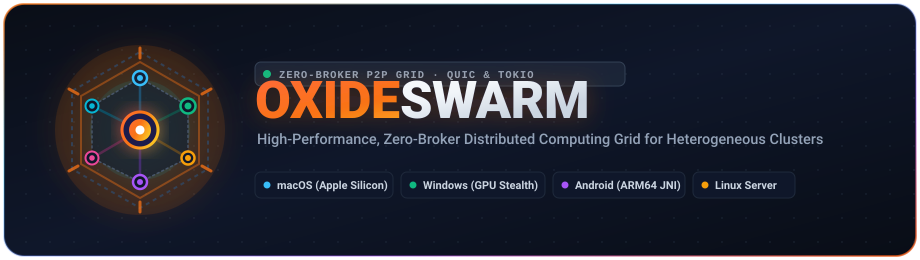

# OxideSwarm

<div align="center">

<p align="center">
  
</p>

**Zero-Broker Distributed Computing Grid for Heterogeneous Clusters**  
*Apple Silicon, Windows GPU PCs, Android phones and Linux boxes working as one personal compute grid*

[](https://www.rust-lang.org)
[](LICENSE)
[](https://github.com/DuongNAD/OxideSwarm/actions/workflows/ci.yml)
[](https://iroh.computer)
[](docs/SECURITY.md)
[](#4-quickstart-guide)

</div>

---

## 1. Overview

**OxideSwarm** is a small distributed computing framework written in Rust. A **master** hands tasks (commands,
shell scripts, compile jobs, map/reduce chunks, GPU-class compute) to **workers** running on your own machines:
Apple Silicon MacBooks, Windows gaming PCs, Android phones and Linux servers.

* **Zero external message brokers**: Tokio actors, 4-byte length-delimited TCP streams and QUIC. No Redis, Kafka, RabbitMQ or ZooKeeper.
* **P2P NAT traversal (`iroh`)**: QUIC with DERP relay fallback connects machines on different networks without opening router ports or setting up a VPN (needs outbound Internet to the public n0 relays).
* **Shared-secret authentication & stream encryption**: only machines holding the same `cluster.secret` can join the grid or drive it, and workers only obey a master that proves it holds the secret. Authenticated TCP connections encrypt wire traffic post-handshake using ChaCha20-Poly1305 (`0x04`) with directional keys derived from the shared secret, while maintaining transparent backward compatibility for unauthenticated loopback dev/test runs. See [docs/SECURITY.md](docs/SECURITY.md).
* **Light background worker**: built as a single native Rust binary without external runtimes (`windows\status_worker.cmd` inspects the live working-set RAM of the running worker). The Windows runner starts headless, without console windows.
* **Quick role swapping and discovery**: `switch_role.sh` / `windows\switch_role.cmd` turn a machine into a master or a worker in a few seconds. Workers can find a master with `--master auto` (authenticated UDP beacon on `:8089`).
* **Decoupled 4-layer layout**: Rust core engine, Android JNI bridge, Agent Mesh coordination hub, cross-machine sync/benchmarks.
* **Process-tree lifecycle and bounded memory**: task process trees are terminated (`taskkill /F /T` / process groups), with LRU task eviction and stale-worker pruning on the master.
* **Task placement and a cluster check**: pin a task to an OS, an architecture, a tag or one worker (`submit --os`, `--arch`, `--require-tag`, `--worker`), send a script and input data with it, and verify a running cluster with `oxideswarm doctor`.

Documentation index and writing standard: [docs/README.md](docs/README.md). A macOS + Windows walk-through, verified end to end: [docs/guides/two-machine-cluster.md](docs/guides/two-machine-cluster.md).

---

## 2. Architecture & Cluster Topology

```text
                            ┌──────────────────────────────────────────────┐
                            │              OXIDESWARM MASTER               │
                            │      (MacBook M-Series OR Windows GPU PC)    │
                            │   Cluster TCP :8088 (secret-authenticated)   │
                            │   Dashboard   :8080 (token; loopback default)│
                            │      UDP LAN discovery beacon :8089          │
                            └───────────────▲───────────────▲──────────────┘
                                            │               │
                            Outbound TCP    │               │  Outbound TCP / QUIC
                           (Auto-Reconnect) │               │  (P2P ticket + secret)
                                            │               │
        ┌───────────────────────────────────┴─┐   ┌─────────┴─────────────────────────────┐
        │        MOBILE COMPUTE NODE          │   │        WINDOWS GPU COMPUTE NODE       │
        │   ARM64 Mobile Node (Galaxy/Pixel)  │   │     Windows Workstation / GPU Rig     │
        │       10 Cores Physical (ARM64)     │   │      (x86_64 + NVIDIA/AMD GPU)        │
        │  • Termux worker or JNI app         │   │  • headless background worker         │
        │  • Auto-cutoff on low battery (<15%)│   │  • Standby portal HTTP 307 redirect   │
        │  • Thermal throttling protection    │   │  • Anti-stuttering host protection    │
        └─────────────────────────────────────┘   └───────────────────────────────────────┘
```

---

## 3. Capabilities & Status

Status values use the fixed vocabulary: `Implemented`, `Partial`, `Planned`, or `Design only`.

| Category / Feature | What it is | Status |
| :--- | :--- | :--- |
| **1. Core grid & zero-broker** | Wire protocol with 4-byte length-delimited framing and dual-mode Serde; 1-byte format discriminator (`0x02` bincode, `0x01` tagged JSON, `0x7B` raw legacy JSON, `0x03` auth handshake, `0x04` AEAD encrypted). | Implemented |
| **2. Master coordinator & scheduler** | 8-state FSM (`Submitted` ➔ `Queued` ➔ `Scheduled` ➔ `Running` ➔ `Completed` / `Failed` / `Retrying` / `Cancelled`), batch-spread scheduling, fast-path recovery when a worker's socket drops (asserted below 200 ms in `tests/m2_challenger_2_stress.rs`), 10 s heartbeat reaper. | Implemented |
| **3. GPU workload routing** | Tasks that require a GPU go only to workers that **advertise** one. A worker advertises a *real* GPU only if its binary was built with `--features gpu-wgpu` **and** the compute engine started on an adapter (looked for automatically at start-up unless `--no-gpu`; `--gpu` insists and prints a warning when that is not possible); a build without wgpu advertises none. `--simulate-gpu` advertises a labelled **simulated** GPU (a CPU multiplication, for testing) and is eligible as well; the master scheduler strictly prioritizes idle hardware GPU (`wgpu`) workers over simulated GPU (`--simulate-gpu`) workers for GPU tasks. | Implemented |
| **4. Anti-stuttering backpressure** | Host CPU/RAM telemetry via `sysinfo`; above 85 % CPU (`--max-host-cpu-pct`) the master defers dispatches to that worker. | Implemented |
| **5. In-memory Map/Reduce** | Chunking, built-in `word_count` / `line_count` / `identity` and `sum` / `count` / `max` / `min` / `concat` kernels, local script shipping (`--mapper ./map.sh`, `--reducer ./reduce.sh`), or worker commands (`--map-cmd`, `--reduce-cmd`). Design: [docs/design/0016-mapreduce-cli-script-shipping.md](docs/design/0016-mapreduce-cli-script-shipping.md). | Implemented |
| **6. Heterogeneous hardware** | macOS, Linux, Android (ARM64), and Windows (x86_64) build targets; see the dated per-platform verification table below. Windows binaries cross-compile (`build_windows_worker.sh`); Windows launchers (`.ps1`, `.cmd`, `.vbs`) are checked statically by `tests/test_launcher_scripts.py`, not executed in automated tests. | Partial |
| **7. Headless Windows worker** | [windows/run_worker_silent.vbs](windows/run_worker_silent.vbs) starts a worker without console windows (it needs the master's `cluster.secret` first); [windows/status_worker.cmd](windows/status_worker.cmd) shows the real working set; [windows/stop_worker.cmd](windows/stop_worker.cmd) stops only the process it started. No PowerShell, `.cmd`, or `.vbs` file runs in any automated test (`tests/test_launcher_scripts.py` checks file text only). | Partial |
| **8. Role swapping** | [switch_role.sh](switch_role.sh) (macOS/Linux) and [windows/switch_role.cmd](windows/switch_role.cmd): stop whatever this launcher started, start the new role, wait until it is up (the macOS/Linux script also checks that a worker registered) and print the next steps. Takes a few seconds. There is **no automatic failover or election**; a person (or script) decides. | Implemented |
| **9. Master discovery & fallback** | Multi-tier coordinator discovery: Tier 1 LAN UDP beacon on `:8089` (`--master auto`) and the `:8080` standby HTTP 307 redirect portal work; Tier 2 HTTP probe (`GET /api/discovery/probe?nonce=<hex>`, served on the dashboard listener, which is loopback by default) and Tier 3 rendezvous registry (`--rendezvous <URL>` / `OXIDESWARM_RENDEZVOUS`) have remaining gaps (see `FEAT-7` in [docs/BACKLOG.md](docs/BACKLOG.md)). Design: [docs/design/0004-mcp-and-discovery.md](docs/design/0004-mcp-and-discovery.md). | Partial |
| **10. Web dashboard** | Axum server serving the SPA `crates/master/src/dashboard.html` (no CDN) plus REST, `/ws` and SSE. Loopback by default; reachable from phones/LAN only when you pass `--web-ui-addr 0.0.0.0:8080` (or `switch_role.sh master --dashboard-lan`); every request off the dev bypass needs the token printed by `oxideswarm secret show --dashboard-token`. | Implemented |
| **11. Workflow modes (`ox-mode`)** | `test` (quick / lint / flaky / full), `dev` (fast check / local cluster on `127.0.0.1:9090` and `127.0.0.1:8080` with automatic ephemeral-port fallback when either port is in use / watch / status discovering the dashboard port through `.dev_cluster.json` or `--port` / `RUSTY_GRID_DASHBOARD_PORT`), `doc` (build / verify with relative-link checks / generated spec summary export), `research` (profile / bench with Bincode wire-codec roundtrips / labeled synthetic scheduling simulation / report). Design: [docs/design/0027-ox-mode-honest-reporting.md](docs/design/0027-ox-mode-honest-reporting.md). | Implemented |
| **12. Benchmarks & chaos** | [run_cluster_benchmark.sh](run_cluster_benchmark.sh) measures parallel SHA-256 task throughput across two local worker processes (or a phone with `--adb-id`), and [run_chaos_test.sh](run_chaos_test.sh) starts its own cluster, kills a worker that holds running tasks, and verifies re-execution. | Implemented |
| **13. Zero-copy I/O & QUIC multiplexing** | `bytes::Bytes` payloads; two iroh streams per connection (`STREAM_CONTROL = 0x01`, `STREAM_DATA = 0x02`) so bulk data cannot block heartbeats; scheduler micro-batching. | Implemented |
| **14. Mid-task checkpointing** | `WorkerMessage::Checkpoint` / `MasterMessage::AssignTaskWithCheckpoint`: `WorkerClient` passes the checkpoint sender to every task (`client.rs:1670`), and `BuiltinTest`, `Generative3D`, and `AutoRig` emit `WorkerMessage::Checkpoint` (`runner.rs:2087`, `:2225`, `:2315`), but `Generative3D` and `AutoRig` ignore the checkpoint on resume (`_checkpoint`, `runner.rs:1909`, `:2286`) and only the hash branch of `BuiltinTest` resumes (`runner.rs:903-908`). | Partial |
| **15. GPU compute (`wgpu`)** | `cargo build --release --bin oxideswarm --features gpu-wgpu` gives a worker that multiplies matrices on the machine's GPU (Metal on macOS, Vulkan / DirectX 12 on Windows and Linux; discrete GPU prioritized over integrated), checks the product against a sampled CPU recomputation and reports `Status: VERIFIED_OK` only if that check passed. A `GpuCompute` task is a **seeded `simulated_matrix_dim` x `simulated_matrix_dim` GEMM** tiled by `work_group_size`. A GPU error, device loss or driver panic fails that task with an explicit message and the engine is rebuilt for the next one. A worker never runs a real-GPU task on the CPU: the CPU path is the labelled `--simulate-gpu` test mode only. Run benchmark with `cargo run --release -p rusty_grid_worker --features gpu-wgpu --example gemm_bench -- 1024`. | Implemented |
| **16. Security** | Shared-secret mutual authentication on the cluster port (TCP and P2P) and on the UDP beacon; authenticated TCP stream encryption via ChaCha20-Poly1305 (`0x04`) with directional keys derived from `cluster.secret`; token-protected, same-origin dashboard; agent-mesh hub token. See [docs/SECURITY.md](docs/SECURITY.md). | Implemented |
| **17. Agent Mesh ↔ Grid bridge** | `AgentGridBridge` lets `agent-mesh hub` run a Master Grid of its own (`--grid-master <ADDR>` starts an embedded master; off loopback it needs a cluster secret or `--insecure`) and routes `grid_compute` / `grid_compile` / `grid_submit` / `grid_status` envelopes to it. When unconfigured, returns `ERR_BRIDGE_NOT_CONFIGURED`. | Implemented |
| **18. Task placement & cluster check** | Workers advertise `os:`, `arch:` and `slots:` (`--max-concurrency` or default headroom) tags plus user tags (`worker --tag`); `submit --os`, `--arch`, `--worker`, `--require-tag`, `--require-isolation` pin a task through `require:` task tags (`require:os=`, `arch=`, `worker=`, `tag=` and `iso=<fs|fs+net>`, a minimum level against the worker's reserved `iso:` tag), so the wire format is unchanged. `submit --stdin-file`, `--script-file`, `--interpreter` and `--env` send input with the task; `--matrix-dim` sizes a GPU task. `oxideswarm cancel <ID>` and `oxideswarm result <ID> [--wait] [--output-dir <DIR>]` cancel tasks or fetch results asynchronously ([design 0010](docs/design/0010-cli-cancel-and-result.md)). `oxideswarm doctor` checks connection, every worker (with its isolation level, `ISO` column and `isolation` in `--json`), process start-up, every GPU and spreading. Design: [docs/design/0001-two-node-readiness.md](docs/design/0001-two-node-readiness.md), [docs/design/0014-worker-max-concurrency-slots-tag.md](docs/design/0014-worker-max-concurrency-slots-tag.md). | Implemented |
| **19. Mobile coordination & battery governance** | Multi-tier throttling $C_{\text{eff}} = \min(C_{\text{bat}}, C_{\text{therm}})$, RRC adaptive keepalive (10s/25s/60s), and pre-sleep evacuation; the 5-rule mobile master refusal matrix (`check_mobile_master_eligibility`, not called in production) and automatic coordinator election (`ClaimMasterRole`, never constructed in production and unconditionally refused by `reject_master_role_claim` in `server.rs`) are design only (there is no automatic failover; see row 8). Design: [docs/design/0002-mobile-coordination.md](docs/design/0002-mobile-coordination.md). | Partial |
| **20. Task input and output files** | `submit --input LOCAL[:SANDBOX]` sends files and whole directories, `--output PATTERN` (`*`, `?`, `**`) brings files back into `--output-dir`. Files move as BLAKE3-named blobs through a bounded store on the master (`~/.oxideswarm/blobs`, `master --blob-dir` / `--blob-store-mb`) in 4 MiB chunks: a client uploads only the blobs the master lacks, a worker fetches only the blobs its cache lacks (`worker --blob-cache-mb`), so an unchanged file is not sent twice. Outputs are capped per task (`worker --output-limit-mb`); `RustCompilation` returns the library or binary it built. Both the CLI and the MCP server (`oxideswarm mcp`) use this content-addressed blob plane. Design: [docs/design/0006-content-addressed-data-plane.md](docs/design/0006-content-addressed-data-plane.md). The older inline staging (at most 32 MiB, retained for wire compatibility and library callers) is [design 0003](docs/design/0003-distributed-file-staging.md). Task output validation and mandatory harvesting failure semantics are documented in [docs/design/0013-task-output-validation-and-harvesting.md](docs/design/0013-task-output-validation-and-harvesting.md). | Partial |
| **21. Model Context Protocol (MCP) server** | Concurrent JSON-RPC 2.0 stdio MCP server (`oxideswarm mcp`) exposing 6 core cluster tools (`status`, `workers`, `submit`, `task_result`, `cancel`, `doctor`) with content-addressed blob staging (`files`, `outputs`, `output_dir`), bounded head-and-tail stream formatting (`max_output_bytes`, `captured_bytes`, `truncated`, `worker_truncated`), client wait deadlines (`wait_secs`), `notifications/cancelled`, `notifications/progress`, pre-dispatch `-32602` argument validation, and strict stdout hygiene. Design: [docs/design/0004-mcp-and-discovery.md](docs/design/0004-mcp-and-discovery.md), [docs/design/0012-mcp-concurrent-deadlines-and-cancel.md](docs/design/0012-mcp-concurrent-deadlines-and-cancel.md), [docs/design/0022-head-and-tail-stream-capture.md](docs/design/0022-head-and-tail-stream-capture.md). | Implemented |
| **22. 3D generative engine names & CPU fallback** | 3D generation tasks (`submit --prompt <PROMPT>`) default to CPU-capable procedural SDF generation and succeed on CPU-only worker nodes without requiring a GPU or `--gpu`. The `--engine` flag strictly enforces supported engines (`sdf`, `triposr`, `auto`), refusing unknown engine names with an informative error rather than silently falling back to `auto`. Design: [docs/design/0015-engine-names-and-cpu-fallback.md](docs/design/0015-engine-names-and-cpu-fallback.md). | Implemented |
| **23. Generative 3D & Procedural SDF** | Pure Rust procedural Signed Distance Field (SDF) mesh generation (`Procedural-SDF-PureRust`) for default (`auto`) and procedural (`sdf`) tiers, honest failure on missing neural model checkpoints, client-side pre-submission validation, and virtual environment isolation. Design: [docs/design/0017-honest-3d-sdf-fallback.md](docs/design/0017-honest-3d-sdf-fallback.md). | Implemented |
| **24. Agent Mesh command hardening & process controls** | Restricts mesh nodes to 5 advertised commands (`echo`, `ping`, `system_info`, `sha256_verify`, `shell_exec`); unadvertised commands return exit 127. `--no-shell` flag filters out `shell_exec` capability and rejects execution requests with 127. Child processes inherit no stdin (`DEVNULL`), output is capped at 1 MiB per stream, and 5 secret env vars are stripped from parent environment inheritance. Design: [docs/design/0011-agent-mesh-hardening.md](docs/design/0011-agent-mesh-hardening.md). | Implemented |
| **25. Head-and-tail task stream capture** | Workers capture up to 10 MiB per output stream (`stdout` and `stderr`) using a split head-and-tail buffer (`first 5 MiB` + truncation notice + rolling `last 5 MiB`) so both startup banners and final build/test summaries survive when a task writes more than 10 MiB. `MapReduceEngine` checks both the legacy tail position and the midpoint position for `[rusty_grid: output truncated after exceeding size limit]`; upgrade the master before workers so an older master does not miss a midpoint marker. Design: [docs/design/0022-head-and-tail-stream-capture.md](docs/design/0022-head-and-tail-stream-capture.md). | Implemented |

### Per-Platform Verification Summary

| Platform | Target | Verified Path | Date | Notes |
| :--- | :--- | :--- | :--- | :--- |
| **macOS (Apple Silicon)** | `aarch64-apple-darwin` | CI run `40269419930` at `3a1c120` and `41276400780` at `c92d1dd` (merge of PR #4, containing `b76d85b`; `fmt`, `clippy`, `cargo test --workspace --lib --locked`, `audit`: Pass); `./test_integration.sh` (Pass), `./run_chaos_test.sh` (Pass), `python3 tests/test_launcher_scripts.py` (Pass), `cargo test --workspace --no-fail-fast` (`1392 passed, 19 failed in 9 test targets`) at `3a1c120`; `cargo test --workspace --locked --no-fail-fast` at `5b16f55` (`1608 passed, 0 failed, 4 ignored` across 117 test binaries, with both an empty temporary `HOME` and a dummy `~/.oxideswarm/cluster.secret` in temporary `HOME`, `TEST-4`) | 2026-11-01 / 2026-11-08 | Recorded in [docs/BACKLOG.md](docs/BACKLOG.md) (`Test baseline` at `3a1c120` and status log for `b76d85b` / merge `c92d1dd`) and `TEST-4` full-suite verification at `5b16f55` |
| **Windows 11 (x86_64)** | `x86_64-pc-windows-msvc` | `cargo test --workspace` (`1132 passed, 0 failed`) and live 2-worker loopback cluster `oxideswarm doctor --expect-workers 2 --gpu-dim 1024` (`8 passed, 0 failed`, including Vulkan `1024x1024` GEMM on RTX 5060 Ti and C6 spread, recorded in [docs/design/0001-two-node-readiness.md](docs/design/0001-two-node-readiness.md) and [docs/guides/two-machine-cluster.md](docs/guides/two-machine-cluster.md)); CI runs `40269419930` (`3a1c120`) and `41276400780` (`c92d1dd`, merge of PR #4 containing `b76d85b`) (`fmt`, `clippy`, `cargo test --workspace --lib --locked`: Pass) | 2026-10-23 / 2026-11-01 | `.ps1`, `.cmd`, and `.vbs` files are checked statically by `tests/test_launcher_scripts.py`, not executed in tests |
| **Ubuntu Linux (x86_64)** | `x86_64-unknown-linux-gnu` | GitHub Actions CI run `40269419930` at `3a1c120` and `41276400780` at `c92d1dd` (merge of PR #4, containing `b76d85b`; `cargo fmt --all -- --check`, `cargo clippy --workspace --all-targets --locked -- -D warnings`, `cargo check -p rusty_grid_master --no-default-features --locked`, `cargo test --workspace --lib --locked`, `cargo audit`: Pass) | 2026-11-01 | Recorded in [docs/BACKLOG.md](docs/BACKLOG.md) (`Test baseline` at `3a1c120` and `INT-1` status log at `b76d85b` / merge `c92d1dd`) |
| **Android (ARM64)** | `aarch64-linux-android` | Not run on a device. Host-side checks at `3a1c120` ([docs/BACKLOG.md](docs/BACKLOG.md)): `crates/android_bridge` unit tests in CI run `40269419930` (`cargo test --workspace --lib --locked`: Pass), and `packaging/android/termux/start_worker.sh` executed in a sandbox by `tests/test_launcher_scripts.py:325-359` (Pass) | 2026-11-01 | Not run on `aarch64-linux-android` hardware; Kotlin app (`packaging/android/app/`) does not compile yet (see `AND-1` in [docs/BACKLOG.md](docs/BACKLOG.md)) |

---

### Known Limitations & Roadmap

| # | Limitation / Goal | Status | Technical details |
|---|---|---|---|
| **1** | Encrypted TCP stream transport | Implemented | After the cluster handshake (version 2) every frame is a ChaCha20-Poly1305 record (`0x04`) with directional keys derived from `cluster.secret`; a tampered, injected, replayed or reordered frame ends the connection, and peers that speak handshake version 1 are refused. No forward secrecy (see [docs/SECURITY.md](docs/SECURITY.md)). Secret-less loopback dev/test runs stay plaintext. Documented in [docs/design/0005-cluster-auth-v2-record-layer.md](docs/design/0005-cluster-auth-v2-record-layer.md). |
| **2** | Automatic master failover & election | Design only | Authority scoring ($S_{\text{auth}}$), the 5-rule mobile refusal matrix (`check_mobile_master_eligibility`, not called in production), and `MasterLeaseTicket` exist in `crates/core/src/arbitrage.rs`, `ProtocolCapabilities::ROLE_ARBITRAGE` (`1 << 7`, `protocol.rs:66`) is not advertised in `all_supported()`, and all `WorkerMessage::ClaimMasterRole` arms in `crates/master/src/server.rs` call `reject_master_role_claim` to refuse every claim with `RoleHandoverAck { accepted: false, task_queue_snapshot: Vec::new(), connected_workers: Vec::new() }`; nothing constructs `ClaimMasterRole` in production and there is no automatic failover or election (`switch_role.sh` and `windows/switch_role.cmd` are manual; see row 8 above). Dynamic worker battery/thermal throttling ($C_{\text{eff}} = \min(C_{\text{bat}}, C_{\text{therm}})$) is documented in [docs/design/0002-mobile-coordination.md](docs/design/0002-mobile-coordination.md). |
| **3** | MCP server for AI agents | Implemented | Concurrent JSON-RPC 2.0 stdio Model Context Protocol (MCP) server (`oxideswarm mcp`) exposing `status`, `workers`, `submit`, `task_result`, `doctor`, and `cancel` tools with content-addressed blob staging, bounded head-and-tail stream formatting, client wait deadlines (`wait_secs`), `notifications/cancelled`, strict JSON-RPC 2.0 framing (`-32700`, `-32600`, `-32602`), and strict stdout transport hygiene. Documented in [docs/design/0004-mcp-and-discovery.md](docs/design/0004-mcp-and-discovery.md), [docs/design/0012-mcp-concurrent-deadlines-and-cancel.md](docs/design/0012-mcp-concurrent-deadlines-and-cancel.md), and [docs/design/0022-head-and-tail-stream-capture.md](docs/design/0022-head-and-tail-stream-capture.md). |
| **4** | Real GPU scheduler preference | Implemented | Master scheduler strictly prioritizes idle hardware GPU (`wgpu`) workers over simulated GPU (`--simulate-gpu`) workers for `requires_gpu` tasks, dispatching to simulated workers only when no hardware GPU is available. |
| **5** | Android app cluster secret auth | Partial | `crates/android_bridge` exposes the `nativeSetClusterSecret` JNI export, and Kotlin `WorkerEngine` accepts `clusterSecret` to authenticate against protected masters (the Kotlin app itself does not compile yet; see `AND-1` in [docs/BACKLOG.md](docs/BACKLOG.md)). |
| **6** | Task input and output files | Partial | Files and directories move as content-addressed blobs across both the CLI and the MCP server (master store, worker cache, 4 MiB chunks, nothing sent twice; [design 0006](docs/design/0006-content-addressed-data-plane.md)). Not yet: compression, pipelined uploads from the CLI (one request in flight per connection, slow for thousands of small files over a high-latency link), `.gitignore`-aware selection (send `src` and `Cargo.toml` rather than a whole project with its `target/`), and symbolic links and empty directories inside input trees. Output validation, symlink rejection and mandatory harvest failure semantics are specified in [design 0013](docs/design/0013-task-output-validation-and-harvesting.md). |
| **7** | UDP discovery on isolated subnets | Partial | 3-tier discovery hierarchy: Tier 1 LAN UDP beacon (`:8089`), Tier 2 authenticated HTTP probe (`GET /api/discovery/probe?nonce=<hex>`, served on the dashboard listener, which is loopback by default), and Tier 3 rendezvous registry (`--rendezvous <URL>` / `OXIDESWARM_RENDEZVOUS`). Tier 2 and Tier 3 have remaining limitations (see `FEAT-7` in [docs/BACKLOG.md](docs/BACKLOG.md)). Documented in [docs/design/0004-mcp-and-discovery.md](docs/design/0004-mcp-and-discovery.md). |
| **8** | Mid-task checkpointing | Partial | `WorkerClient` passes the checkpoint sender to every task (`client.rs:1670`), and `BuiltinTest`, `Generative3D`, and `AutoRig` send `WorkerMessage::Checkpoint` (`runner.rs:2087`, `:2225`, `:2315`), but `Generative3D` and `AutoRig` ignore the checkpoint on resume (`_checkpoint`, `runner.rs:1909`, `:2286`) and only the hash branch of `BuiltinTest` resumes from `CheckpointData` (`runner.rs:903-908`); all other task types and branches restart from the beginning when reassigned (see `FEAT-5` in [docs/BACKLOG.md](docs/BACKLOG.md)). |
| **9** | OS child process containment | Implemented | On Windows, task child processes are bound to a Job Object (`JOB_OBJECT_LIMIT_KILL_ON_JOB_CLOSE` with `CREATE_SUSPENDED`) to kill the process tree on worker termination, falling back to `taskkill /F /T` if job assignment fails. On Unix (`Linux`, `macOS`, `Android`), each task process group is watched by a double-forked lifeline-pipe supervisor (`process_tree.rs`) that kills the process group (`SIGTERM` then `SIGKILL`), any delegated Linux cgroup v2 leaf, and `setsid()` survivors matching the per-attempt `RUSTY_GRID_RUN_TOKEN` when the worker crashes or is killed with `SIGKILL` ([docs/design/0031-containment-after-worker-crash.md](docs/design/0031-containment-after-worker-crash.md)). Start-up host capability probes (`blender --version`, `sysctl`, `nvidia-smi`, `pmset`, `dumpsys`, `getprop`, `sw_vers`, `nvcc`) are bounded to `3 s` (`HOST_PROBE_TIMEOUT`). On Windows, `resolve_windows_executable` (`runner.rs`) resolves task executables across the fixed extension list `[".com", ".exe", ".bat", ".cmd"]` (in `PATHEXT`'s default order) with a 2-byte `MZ` PE header check on `.com`/`.exe` and keeps Git for Windows `usr\bin` and `bin` ahead of `PATH` for bare names so extensionless files or 0-byte stubs cannot fail `CreateProcessW` with `os error 193`. Documented in [docs/design/0009-blender-and-3d-process-supervision.md](docs/design/0009-blender-and-3d-process-supervision.md), [docs/design/0020-bounded-host-capability-probes.md](docs/design/0020-bounded-host-capability-probes.md), [docs/design/0025-windows-executable-resolution.md](docs/design/0025-windows-executable-resolution.md), and [docs/design/0031-containment-after-worker-crash.md](docs/design/0031-containment-after-worker-crash.md). |
| **10** | Protocol version & capability negotiation | Implemented | Workers, the master, and clients (`ClientMessage` and `ClientResponse`, protocol version 6) exchange and enforce `protocol_version` (`PROTOCOL_VERSION_MIN_COMPATIBLE..=PROTOCOL_VERSION_CURRENT`, with `LEGACY_UNVERSIONED_PROTOCOL_VERSION = 2` for unversioned JSON frames and a pre-flight `Hello` check in `connect_master` before any state-changing command), `WorkerClient` gates runtime capabilities on the `ProtocolCapabilities` bits acknowledged in `RegisterAck`, and `crates/core/src/wire_layout_tests.rs` (plus CI against `origin/master`) requires bumping `PROTOCOL_VERSION_CURRENT` and `PROTOCOL_VERSION_MIN_COMPATIBLE` whenever recorded bincode bytes change. Documented in [docs/design/0040-protocol-versioning.md](docs/design/0040-protocol-versioning.md). |
| **11** | 3D generative engine names and CPU fallback | Implemented | Default 3D generation executes on CPU worker nodes via procedural SDF without GPU hardware. Strict validation refuses unknown engine names across CLI, core builder, Agent Mesh bridge, and wire codecs (JSON and bincode). Documented in [docs/design/0015-engine-names-and-cpu-fallback.md](docs/design/0015-engine-names-and-cpu-fallback.md). |
| **12** | Honest 3D procedural SDF fallback | Implemented | Default (`auto`) and procedural (`sdf`) 3D generation routes to pure Rust Tier 0 Signed Distance Functions (`Procedural-SDF-PureRust`). Uninstalled neural checkpoints fail non-zero with explicit diagnostic reasons, `--image` inputs reject fast client-side, and subprocess failures propagate terminal stderr in `result.error`. Documented in [docs/design/0017-honest-3d-sdf-fallback.md](docs/design/0017-honest-3d-sdf-fallback.md). |
| **13** | Exactly-once execution | Planned | Task delivery is at-least-once: if a worker disconnects, times out on heartbeats, or fails over after starting a task (or before the master processes its `WorkerMessage::TaskResult`, `protocol.rs:443`), the master requeues and dispatches the task to another worker, and the process tree of a killed worker can also keep running (`run_chaos_test.sh:309`), so a task can run twice. Tasks with external side effects must be idempotent. |

---

## 4. Quickstart Guide

Ports: **8088** is the cluster port (workers and `submit` / `status` talk to it), **8080** is the dashboard
(never a valid `--master` target), **8089/udp** is discovery. Details: [docs/SECURITY.md](docs/SECURITY.md#4-what-each-port-exposes).

### Step 0: Build

```bash
cargo build --release --bin oxideswarm --bin rusty-grid     # the two names are the same program
# Add --features gpu-wgpu on a machine whose GPU should do work (Apple Silicon Mac, Windows GPU PC);
# without it the worker cannot use the GPU and advertises none:
cargo build --release --bin oxideswarm --features gpu-wgpu
```

### Step 1: Start the master and share the secret

```bash
# macOS / Linux: cluster port 8088 on every interface, dashboard on this machine only, plus a local worker
./switch_role.sh master
./switch_role.sh master --p2p              # also publish a P2P ticket for machines on other networks (step D)
./switch_role.sh master --dashboard-lan    # also open the dashboard (:8080) to phones / the LAN
./switch_role.sh master --no-worker        # master only

# the same by hand
./target/release/oxideswarm master --listen 0.0.0.0:8088
./target/release/oxideswarm master --listen 0.0.0.0:8088 --p2p --p2p-ticket-file ~/.oxideswarm/master_ticket.txt
```

Windows master: `windows\switch_role.cmd master [--p2p] [--lan-dashboard]`.

The first start of a master that other machines can reach creates **`~/.oxideswarm/cluster.secret`** and prints
where it is. **Copy that file to every machine that should join** (workers and anyone running `submit`), over a
channel you trust, for example:

```bash
scp user@master:~/.oxideswarm/cluster.secret ~/.oxideswarm/cluster.secret && chmod 600 ~/.oxideswarm/cluster.secret
```

(Windows: `%USERPROFILE%\.oxideswarm\cluster.secret`; a USB stick works too. Never chat, e-mail or cloud-synced folders.)
A master bound to loopback only (plain `oxideswarm master`) needs no secret. The dashboard token is
`oxideswarm secret show --dashboard-token`. More: [docs/SECURITY.md](docs/SECURITY.md).

### Step 2: Connect compute workers

For a Mac and a Windows PC, follow [docs/guides/two-machine-cluster.md](docs/guides/two-machine-cluster.md): it covers
the link (Wi-Fi, Ethernet, P2P), both roles and the check with `oxideswarm doctor`.

#### A. Windows GPU rig (headless background worker)
Put the master's `cluster.secret` into `%USERPROFILE%\.oxideswarm\`, then in the `windows\` folder:
* Double-click [`windows/run_worker_silent.vbs`](windows/run_worker_silent.vbs) (looks for the master with `auto`), or
* run `windows\switch_role.cmd worker <MASTER_IP>:8088`, or `windows\start_worker.cmd <MASTER_IP>:8088`
  (the worker uses the GPU only if `rusty-grid.exe` was built with `--features gpu-wgpu`, e.g.
  `./build_windows_worker.sh --gpu`; it then finds the card itself and prints the adapter at start-up, and
  without that feature it says so and advertises **no** GPU, also with `--gpu`), or
* install a service that starts at boot: `windows\install_service.cmd <MASTER_IP>:8088 C:\path\to\cluster.secret`
  (runs as the low-privilege virtual account `NT SERVICE\OxideSwarmWorker`, not SYSTEM; see
  [packaging/windows/README.md](packaging/windows/README.md)).

#### B. Android phone (Samsung Galaxy / Pixel)
* **Termux worker (works with the secret today)**: [`packaging/android/termux`](packaging/android/README.md): run
  `install_termux_daemon.sh`, put the master's cluster address (`<MASTER_IP>:8088`) and the copied secret in place,
  then `start_worker.sh --daemon`.
* **Android app (JNI)**: build `liboxideworker.so` first with `packaging/android/build_android_jni.sh --release`
  and then the APK ([guide](packaging/android/README.md)). Supports native cluster secret configuration via
  `nativeSetClusterSecret` (note: the Gradle APK project in `packaging/android/app/` does not compile yet; see `AND-1` in [docs/BACKLOG.md](docs/BACKLOG.md)).
* **Dashboard from the phone**: start the master with `--dashboard-lan`, open `http://<MASTER_IP>:8080` and log in with
  the token from `oxideswarm secret show --dashboard-token`. The page's **"Scan Master"** button probes the current
  host, hosts saved in the browser and hosts the master lists in `/api/status`; it does not scan your subnet.

#### C. Instant role swapping (promote Windows to master)
* On the Windows PC: `windows\switch_role.cmd master` (or menu option `1`).
* On the Mac: `./switch_role.sh worker <WINDOWS_IP>:8088` (or menu option `2`).
Both machines need the same `cluster.secret` first. Nothing else is killed: the launchers stop only the processes
they started (PID files in `~/.oxideswarm/run`).

#### D. Remote WAN Connection (Cross-Network / Internet — requires Ticket AND Secret)
When two machines are on different networks (e.g., laptop on remote Wi-Fi, desktop compute node at home/office):
1. **On the Master coordinator**, enable P2P: `./switch_role.sh master --p2p` (or `oxideswarm master --listen 0.0.0.0:8088 --p2p --p2p-ticket-file ~/.oxideswarm/master_ticket.txt`). The master requires outbound Internet access to reach public Iroh (n0) DERP relays.
   - The connection ticket is written to `~/.oxideswarm/master_ticket.txt`, printed in console output, or copied via the **"📋 Copy P2P Ticket"** button in the Web Dashboard.
   - The ticket remains deterministic across restarts if `~/.oxideswarm/master_key.bin` is preserved and relays are reachable during startup.
2. **Copy the cluster secret** `~/.oxideswarm/cluster.secret` from the Master to the worker machine via `scp`, SSH, or physical USB drive. The P2P ticket provides address routing only and does not establish authorization; workers refuse pairing if the secret is missing (unless `--insecure` is explicitly passed).
3. **On the Worker machine**:
   - **macOS / Linux**: Run `./connect_remote.sh "<TICKET>" --secret-file /path/to/cluster.secret` (or execute without arguments to paste interactively). The ticket is persisted to `~/.oxideswarm/remote-worker.toml` (mode 0600) without modifying default configs. Pass `--service` to install a user-level LaunchDaemon on macOS.
   - **Windows**: Double-click [`connect_remote.cmd`](connect_remote.cmd) and paste the ticket when prompted (avoid passing JSON via command-line arguments to prevent shell character stripping). The script requests elevation, installs the `OxideSwarmWorker` service under the virtual account `NT SERVICE\OxideSwarmWorker`, and awaits registration confirmation.
4. **Automated Path Routing**:
   - Nodes attempt UDP hole-punching for direct zero-broker connectivity (`🟢 Direct P2P | <RTT>ms`).
   - If UDP traffic is restricted by carrier CGNAT or firewalls, traffic automatically routes through encrypted HTTPS relays (`🟣 DERP Relay | <RTT>ms`).
   - Comparative performance benchmarks are documented in the [Interconnect Benchmark Report](benchmarks/interconnect/COMPARATIVE_INTERCONNECT_BENCHMARK.md).
   - P2P communication is encrypted via TLS by Iroh, in addition to HMAC-SHA256 cluster secret verification.

#### E. Cross-Machine Shared-Folder Probe (`scripts/sync_network`)
A lightweight utility for two machines sharing a cloud-synchronized folder (e.g., Google Drive, OneDrive, or local NFS/SMB share) to verify peer visibility:
- **Role Assignment (SERVER / CLIENT)**: Mediated via ephemeral `claim_<platform>.json` tokens in the shared directory (claims older than 180 seconds are invalidated).
- **HTTP Ping on Port 8085**: Direct reachability check between hosts; writes `ping_success.txt` upon verification or generates detailed troubleshooting logs.
- **Process & Secret Isolation**: The probe does not interact with the Rust compute grid (ports 8088, 8080, 8089) and never exchanges tickets or secrets. Secrets must never be stored in cloud-synced storage.
- For complete details, see [scripts/sync_network/README.md](scripts/sync_network/README.md).

### Troubleshooting

Start with `oxideswarm doctor --expect-workers <N>` on any machine that holds the secret: it names the check that fails.

| Symptom | Likely cause and fix |
| :--- | :--- |
| `submit` warns that no connected worker matches the placement constraints | `--os`, `--arch`, `--worker` or `--require-tag` names something no connected worker has. The task waits in the queue; start that worker or fix the constraint (`workers --json` lists the `os:`, `arch:`, `id:` and user tags). |
| `Authentication required: ...` / `refusing to connect ... without a cluster secret` (exit code 6) | This machine has no (matching) secret. Copy `~/.oxideswarm/cluster.secret` from the master, or pass `--secret-file PATH`. `--insecure` skips the check and is only for networks you fully control. |
| `Authentication failed` | The secrets differ, e.g. the master ran `secret generate --force`. Copy the master's file again and restart the worker. |
| Worker logs `Connection refused` or times out | Wrong port (use the **cluster** port 8088, not the dashboard's 8080); the master listens on loopback only (the default; start it with `--listen 0.0.0.0:8088`); a firewall blocks 8088. |
| A worker started without `--master` never registers and logs P2P or `Invalid P2P ticket` errors | A stale `p2p_ticket` sits in the config file the CLI auto-loads (`RUSTY_GRID_CONFIG`, `./rusty-grid.toml` or `./rusty-grid.json` — skipped by `mcp` — or `~/.oxideswarm/rusty-grid.toml`). Pass `--master HOST:8088` (which overrides `[worker].p2p_ticket`) or remove `p2p_ticket` from the config file. `connect_remote.sh` now writes `remote-worker.toml` instead and never touches `rusty-grid.toml`. |
| `submit` fails with `Task queue is full (<N> queued or running tasks; wait, or raise --max-queue-size)` (exit code 1) | The master has `<N>` active (queued, scheduled, running, or retrying) tasks and reached `--max-queue-size`. Wait for running tasks to finish, or restart the master with a higher `--max-queue-size`. |
| `--master auto` finds nothing | The UDP beacon (`:8089`) is not routed (Wi-Fi client isolation, another subnet, VPN) or the beacon's secret does not match. Use `HOST:8088`. |
| Dashboard answers `401` or shows a login prompt | Paste the token from `oxideswarm secret show --dashboard-token` (on the master). A phone can only reach the dashboard if the master was started with `--web-ui-addr 0.0.0.0:8080` / `--dashboard-lan`. |
| `Address already in use` on 8088 | Another master, or the agent-mesh hub (it also defaults to 8088). Stop it or choose another port (`OXIDESWARM_CLUSTER_PORT` for the launchers, `--listen` by hand). |
| P2P pairing hangs | The master needs `--p2p` and Internet access to the public relays; the pairing machine needs the ticket **and** the secret. |
| `GPU tasks never reach the GPU` / `worker starts with "no GPU is advertised"` | The binary was built without the wgpu engine. Rebuild with `cargo build --release --bin oxideswarm --features gpu-wgpu` (Windows cross-build: `./build_windows_worker.sh --gpu`); the worker prints `GPU compute enabled on <adapter>` at start-up when it works (see Capabilities #15). `--gpu` on a binary without the engine is ignored with a warning. |
| A GPU task fails with `GPU unavailable` / `GPU device error` | The worker advertised a GPU but the engine could not use it (no adapter, driver reset). The task failed instead of running on the CPU; the next task rebuilds the engine. Check the worker log. |

---

## 5. CLI Reference & Workflow Modes (`ox-mode`)

OxideSwarm includes a unified CLI management tool:

```bash
# Launch the interactive terminal UI (TUI) menu:
./ox-mode

# Code Quality & Testing Mode (Linting + Flaky test detection):
./ox-mode test lint
./ox-mode test flaky --iterations 5

# Development Mode (Live-reload file watcher and local dev cluster):
./ox-mode dev watch
./ox-mode dev cluster   # binds 127.0.0.1:9090 and 127.0.0.1:8080 (or falls back to free ephemeral ports recorded in .dev_cluster.json)
./ox-mode dev status    # probes the dashboard port from .dev_cluster.json (or --port / 8080)
./ox-mode dev stop

# Research & Performance Profiling Mode:
./ox-mode research bench
./ox-mode research distributed
```

### Direct CLI commands (`oxideswarm` / `rusty-grid`)

`oxideswarm` and `rusty-grid` are the same program (`rusty-grid` is the older name; use either). Every command
accepts `--help`. Clients and workers read the cluster secret from `--secret-file`, `OXIDESWARM_SECRET_FILE`,
or `~/.oxideswarm/cluster.secret`.

```bash
# Master. Default listen is 127.0.0.1:8088 (this machine only); other machines need 0.0.0.0:8088.
./target/release/oxideswarm master --listen 0.0.0.0:8088
# Persist the task queue across master restarts (snapshot.bin + journal.bin; defaults --blob-dir to <DIR>/blobs):
./target/release/oxideswarm master --listen 0.0.0.0:8088 --state-dir ~/.oxideswarm/state
# Raise active and finished-task memory budgets (each defaults to 256 MiB):
./target/release/oxideswarm master --listen 0.0.0.0:8088 --max-active-mb 512 --max-retained-mb 512
# Dashboard on the LAN as well (explicit; default is loopback):
./target/release/oxideswarm master --listen 0.0.0.0:8088 --web-ui-addr 0.0.0.0:8080
# Register with Tier 3 HTTP rendezvous registry:
./target/release/oxideswarm master --listen 0.0.0.0:8088 --rendezvous http://rendezvous.example.com:8080

# Worker: --master takes the CLUSTER port (default 127.0.0.1:8088; a bare host gets :8088; 'auto' = LAN discovery)
./target/release/oxideswarm worker --master 192.168.1.100:8088
./target/release/oxideswarm worker --master 192.168.1.100:8088                  # a --features gpu-wgpu build finds and uses the GPU itself
./target/release/oxideswarm worker --master 192.168.1.100:8088 --gpu            # insist: warns and advertises no GPU if there is none / no wgpu
./target/release/oxideswarm worker --master 192.168.1.100:8088 --no-gpu         # keep this machine's GPU out of the grid
./target/release/oxideswarm worker --master auto --rendezvous http://rendezvous.example.com:8080  # discover via Tier 3 fallback

# Submit work (--command is the executable, arguments follow after --; the file must exist on the worker)
./target/release/oxideswarm submit --master 127.0.0.1:8088 --command echo --wait -- hello
./target/release/oxideswarm submit --master 127.0.0.1:8088 --command sha256sum --wait -- /path/present/on/the/worker
./target/release/oxideswarm submit --master 127.0.0.1:8088 --type gpu --gpu --wait   # routed to a worker that advertises a GPU

# Input and output files: send a file or a directory, bring back what the patterns select
# (files the master already holds are not sent again; outputs land in --output-dir at their sandbox paths; --output-dir requires --output)
./target/release/oxideswarm submit --input input.dat --output results.csv --output-dir out/ --command process_data -- input.dat results.csv
./target/release/oxideswarm submit --input ./my-crate:. --output 'target/release/my-crate' --output-dir out/ --timeout-secs 600 --command cargo -- build --release
./target/release/oxideswarm submit --input data/ --output 'reports/**/*.json' --type shell --script-file analyse.sh

# Worker with user tags (matched by `submit --require-tag`); os:/arch: tags are added automatically
./target/release/oxideswarm worker --master <MASTER_IP>:8088 --tag laptop --tag office
# A second worker on the same machine: give it its own name and no standby portal on :8080
./target/release/oxideswarm worker --master <MASTER_IP>:8088 --name <NAME>-2 --no-portal

# Pin a task to an OS, an architecture, a tag or one worker (a name, or an id from `workers --json`)
./target/release/oxideswarm submit --os windows --wait --command cmd -- /C ver
./target/release/oxideswarm submit --worker <WORKER_NAME> --wait -- uname -a
./target/release/oxideswarm submit --require-tag laptop --arch x86_64 --wait -- hostname

# Send input with the task (each file at most 32 MiB): a script, standard input, environment variables
./target/release/oxideswarm submit --type shell --interpreter python3 --script-file job.py --wait
./target/release/oxideswarm submit --stdin-file data.txt --env MODE=fast --wait --command wc -- -l

# GPU task of a chosen size (default 64; up to 8192 on a real GPU, 2048 on the simulated one)
./target/release/oxideswarm submit --type gpu --matrix-dim 2048 --wait

# 3D mesh generation: default runs on CPU via procedural SDF and writes a glTF 2.0 binary asset
./target/release/oxideswarm submit --prompt "a solid cube" -o cube.glb --wait
./target/release/oxideswarm submit --prompt "robot" --engine sdf -o robot.glb --wait

# Inspect the grid, fetch task results, or cancel a task
./target/release/oxideswarm workers --master 127.0.0.1:8088
./target/release/oxideswarm status --master 127.0.0.1:8088 --json
./target/release/oxideswarm result <TASK_ID> --wait --output-dir out/
./target/release/oxideswarm cancel <TASK_ID>
./target/release/oxideswarm mapreduce --master 127.0.0.1:8088 --input data.txt --mapper word_count --reducer sum
# `--mapper` / `--reducer` ship local .sh scripts to workers; `--map-cmd` / `--reduce-cmd` run scripts/binaries that are already on every worker
./target/release/oxideswarm mapreduce --master 127.0.0.1:8088 --input data.txt --mapper ./map.sh --reducer ./reduce.sh
./target/release/oxideswarm mapreduce --master 127.0.0.1:8088 --input data.txt --map-cmd "python3 /tmp/map.py" --reduce-cmd "python3 /tmp/reduce.py"

# Model Context Protocol (MCP) stdio server for AI coding assistants
./target/release/oxideswarm mcp --master 127.0.0.1:8088

# Check the whole cluster: every worker, process start-up, every GPU, spreading
# (exit code 0 = all checks passed, 1 = a check failed, 6 = authentication failed)
./target/release/oxideswarm doctor --expect-workers 2
./target/release/oxideswarm doctor --json --skip-gpu

# Secret management
./target/release/oxideswarm secret generate
./target/release/oxideswarm secret show --dashboard-token
```

Exit code `6` means authentication failed. Remote or auto-discovered masters are refused without a secret unless
you pass `--insecure` (`RUSTY_GRID_INSECURE=1`, or `insecure = true` under `[master]`, `[worker]`, `[submit]`, or `[status]` in `rusty-grid.toml`).

### Complete CLI Flag Reference (`oxideswarm` / `rusty-grid`)

Every subcommand inherits the global flags below and responds to `--help` (`-h`) and `--version` (`-V`).

#### Global Flags (`oxideswarm [GLOBAL_FLAGS] <SUBCOMMAND>`)
| Flag / Alias | Default / Env / Config | Description |
| :--- | :--- | :--- |
| `-c`, `--config <PATH>` | `RUSTY_GRID_CONFIG`, `./rusty-grid.{toml,json}`, `~/.oxideswarm/rusty-grid.toml` | Path to configuration file (`oxideswarm mcp` skips working-directory config files unless `--config` or `RUSTY_GRID_CONFIG` is set) |
| `-v`, `--verbose` | `RUST_LOG=debug` | Enable verbose debug logging |
| `-q`, `--quiet` | `RUST_LOG=error` | Suppress informational output (errors only) |
| `--secret-file <PATH>` | `OXIDESWARM_SECRET_FILE`, `secret_file`, `~/.oxideswarm/cluster.secret` | File containing the 64-hex-character cluster secret (mode `0600`) |
| `--secret <HEX>` | `OXIDESWARM_SECRET`, `secret` | Cluster secret as 64 hex characters (hidden from `--help` because command-line arguments are visible in `ps`; prefer `--secret-file` or `OXIDESWARM_SECRET_FILE`) |
| `-h`, `--help` | — | Print help information |
| `-V`, `--version` | — | Print version information |

#### `oxideswarm master` Flags
| Flag / Alias | Default / Env / Config | Description |
| :--- | :--- | :--- |
| `--listen <ADDR>` | `127.0.0.1:8088` (`RUSTY_GRID_MASTER_LISTEN`, `RUSTY_GRID_LISTEN`, `[master].listen`) | Grid TCP listen address (`0.0.0.0:8088` to accept workers on other machines) |
| `--port-file <PATH>` (alias `--portfile`) | `RUSTY_GRID_PORT_FILE`, `[master].port_file` | File path where the bound TCP grid port number is written |
| `--heartbeat-interval-secs <SECS>` (alias `--heartbeat-interval`) | `3` (`RUSTY_GRID_HEARTBEAT_INTERVAL_SECS`, `[master].heartbeat_interval_secs`) | Expected worker heartbeat interval in seconds |
| `--heartbeat-timeout-secs <SECS>` (alias `--heartbeat-timeout`) | `10` (`RUSTY_GRID_HEARTBEAT_TIMEOUT_SECS`, `[master].heartbeat_timeout_secs`) | Seconds without a heartbeat before a worker is marked dead |
| `--reaper-interval-secs <SECS>` (alias `--reaper-interval`) | `1` (`RUSTY_GRID_REAPER_INTERVAL_SECS`, `[master].reaper_interval_secs`) | Interval in seconds between dead-worker reaper sweeps |
| `--max-queue-size <N>` | Unbounded by count (`RUSTY_GRID_MAX_QUEUE_SIZE`, `[master].max_queue_size`) | Maximum queued or running (non-terminal) tasks allowed in the queue at once (minimum `1`; when full, `oxideswarm submit` exits `1` and advises waiting or raising `--max-queue-size`; `--max-active-mb` also bounds active queue memory) |
| `--scheduler-policy <POLICY>` | `weighted` (`RUSTY_GRID_SCHEDULER_POLICY`, `[master].scheduler_policy`) | Load-balancing policy across eligible workers: `weighted` (`weighted-least-loaded`), `least-loaded`, or `round-robin` |
| `--default-retry-max <N>` (alias `--max-retries`) | `3` (`RUSTY_GRID_DEFAULT_RETRY_MAX`, `RUSTY_GRID_MAX_RETRIES`, `[master].default_retry_max`) | Default maximum execution retries per task |
| `--max-host-cpu-pct <PCT>` | `85.0` (`RUSTY_GRID_MAX_HOST_CPU_PCT`, `[master].max_host_cpu_pct`) | Host CPU percentage ceiling before anti-stuttering backpressure throttles dispatch |
| `--preserve-gpu <BOOL>` | `true` (`RUSTY_GRID_PRESERVE_GPU`, `[master].preserve_gpu`) | Reserve GPU workers for GPU-requiring tasks when CPU-only workers are available |
| `--fail-unfulfillable-tasks [BOOL]` | `false` (`RUSTY_GRID_FAIL_UNFULFILLABLE_TASKS`, `[master].fail_unfulfillable_tasks`) | When at least one connected (`Connected` or `Busy`) worker is schedulable, immediately fail tasks whose required capabilities or placement constraints no registered worker can satisfy (`--fail-unfulfillable-tasks` with no value sets `true`). A task whose only matching worker is `Disconnected` stays queued until that worker reconnects or is pruned `1 hour` after its last heartbeat (`ReaperConfig::stale_worker_timeout` in `crates/master/src/reaper.rs`, no CLI flag), so a `--wait` caller blocks until then (or `--timeout-secs`). |
| `--p2p` | `false` (`RUSTY_GRID_P2P`, `[master].p2p`) | Enable Iroh QUIC/DERP P2P endpoint for NAT traversal |
| `--p2p-ticket-file <PATH>` | `RUSTY_GRID_P2P_TICKET_FILE`, `[master].p2p_ticket_file` | File path where the generated P2P connection ticket is written |
| `--p2p-key-file <PATH>` (alias `--key-file`) | `~/.oxideswarm/master_key.bin` (`RUSTY_GRID_P2P_KEY_FILE`, `[master].p2p_key_file`) | Persistent P2P secret key file for stable NodeId and ticket across restarts |
| `--ephemeral-key` | `false` (`RUSTY_GRID_EPHEMERAL_KEY`) | Force a random ephemeral P2P key instead of persisting `master_key.bin` |
| `--wire-codec <CODEC>` | `bincode` (`RUSTY_GRID_WIRE_CODEC`, `[master].wire_codec`) | Wire format codec: `bincode` or `json` |
| `--web-ui-addr <ADDR>` | `127.0.0.1:8080` | Bind address for the embedded HTTP web dashboard (`0.0.0.0:8080` exposes it on the LAN) |
| `--dashboard-port <PORT>` | `8080` (`RUSTY_GRID_DASHBOARD_PORT`, `OXIDE_SWARM_DASHBOARD_PORT`, `[master].dashboard_port`) | HTTP port for the embedded web dashboard (ignored if `--web-ui-addr` is given) |
| `--dashboard-port-file <PATH>` | `RUSTY_GRID_DASHBOARD_PORT_FILE`, `OXIDE_SWARM_DASHBOARD_PORT_FILE`, `[master].dashboard_port_file` | File path where the bound dashboard HTTP port number is written |
| `--dev` | `false` (`OXIDE_DEV_MODE`) | Enable local development mode (bypasses dashboard token auth on loopback interfaces only) |
| `--auth-token <TOKEN:NAME:SCOPES>` | Repeatable | Register an explicit dashboard API bearer token with comma-separated scopes (`admin`, `submit`, `observer`) |
| `--insecure` | `false` (`RUSTY_GRID_INSECURE`, `[master].insecure`) | Allow a non-loopback or `--p2p` master to run without a cluster secret |
| `--max-retained-tasks <N>` | `10000` (`RUSTY_GRID_MAX_RETAINED_TASKS`, `[master].max_retained_tasks`) | Finished tasks retained in memory before evicting the oldest |
| `--max-retained-mb <MB>` | `256` (`RUSTY_GRID_MAX_RETAINED_MB`, `[master].max_retained_mb`) | Megabytes of finished-task payload and output retained in memory |
| `--max-active-mb <MB>` | `256` (`RUSTY_GRID_MAX_ACTIVE_MB`, `[master].max_active_mb`) | Megabytes of active (queued, scheduled, running, retrying) task payloads held at once (minimum `1`) |
| `--state-dir <DIR>` | In-memory only (`RUSTY_GRID_STATE_DIR`, `[master].state_dir`) | Directory of the durable task queue store (`store.lock`, `snapshot.bin`, `journal.bin`, mode `0700`/`0600` on Unix; persists task specs, `env`, `stdin`, and results in plaintext and defaults `--blob-dir` to `<DIR>/blobs` when `--blob-dir` is not set) |
| `--blob-dir <DIR>` | `<state_dir>/blobs` when `--state-dir` is set, else `~/.oxideswarm/blobs` (`RUSTY_GRID_BLOB_DIR`, `[master].blob_dir`) | Directory of the content-addressed blob store for task input and output files |
| `--blob-store-mb <MB>` | `4096` (`RUSTY_GRID_BLOB_STORE_MB`, `[master].blob_store_mb`) | Megabytes the master blob store holds before LRU eviction of unreferenced blobs |
| `--mapreduce-parallelism <N>` | `256` (`RUSTY_GRID_MAPREDUCE_PARALLELISM`, `[master].mapreduce_parallelism`) | Maximum map or reduce chunk tasks of one `mapreduce` job in flight at once |
| `--max-connections <N>` | `1024` (`RUSTY_GRID_MAX_CONNECTIONS`, `[master].max_connections`) | Maximum concurrent connections kept open on the grid port |
| `--max-pending-handshakes <N>` | `64` (`RUSTY_GRID_MAX_PENDING_HANDSHAKES`, `[master].max_pending_handshakes`) | Maximum connections allowed in the pre-authentication handshake state at once |
| `--rendezvous <URL>` | `OXIDESWARM_RENDEZVOUS`, `RUSTY_GRID_RENDEZVOUS` | URL of Tier 3 HTTP rendezvous registry for cross-subnet discovery |

#### `oxideswarm worker` Flags
| Flag / Alias | Default / Env / Config | Description |
| :--- | :--- | :--- |
| `--master <ADDR\|auto>` | `127.0.0.1:8088` (`RUSTY_GRID_MASTER_ADDR`, `RUSTY_GRID_MASTER`, `[worker].master`) | Master grid port address (`HOST:8088`, bare `HOST`, or `auto` for LAN discovery) |
| `--p2p-ticket <TICKET>` | `RUSTY_GRID_P2P_TICKET`, `[worker].p2p_ticket` | Iroh P2P connection ticket for joining a remote master across NAT/WAN |
| `--name <NAME>` | Hostname (`RUSTY_GRID_WORKER_NAME`, `RUSTY_GRID_NAME`, `[worker].name`) | Worker node name override; persists worker UUID in `~/.oxideswarm/worker_id.<NAME>` |
| `--tag <TAG>` | Repeatable (`RUSTY_GRID_WORKER_TAGS`, `[worker].tags`) | User tag advertised to the master and matched by `submit --require-tag` |
| `--cores <N>` (alias `--cpu-cores`) | Auto-detected (`RUSTY_GRID_CORES`, `RUSTY_GRID_CPU_CORES`, `[worker].cores`) | Override advertised CPU core count |
| `--ram-mb <MB>` (aliases `--override-ram-mb`, `--ram`) | Auto-detected (`RUSTY_GRID_RAM_MB`, `RUSTY_GRID_OVERRIDE_RAM_MB`, `[worker].ram_mb`) | Override advertised RAM in megabytes |
| `--gpu` | `false` (`RUSTY_GRID_GPU`, `RUSTY_GRID_ENABLE_GPU`, `[worker].gpu`) | Insist on a real hardware wgpu adapter (warns if unavailable or built without `gpu-wgpu`) |
| `--no-gpu` | `false` (`RUSTY_GRID_NO_GPU`, `[worker].no_gpu`) | Never probe or advertise a GPU |
| `--simulate-gpu` | `false` (`RUSTY_GRID_SIMULATE_GPU`, `[worker].simulate_gpu`) | Test mode: advertise a simulated GPU backed by CPU execution (`is_simulated_gpu = true`) |
| `--gpu-name <NAME>` | Auto-detected (`RUSTY_GRID_GPU_NAME`, `[worker].gpu_name`) | Override advertised GPU model name |
| `--vram-mb <MB>` | Auto-detected (`RUSTY_GRID_VRAM_MB`, `RUSTY_GRID_GPU_VRAM_MB`, `OXIDE_SWARM_VRAM_MB`, `[worker].vram_mb`) | Override advertised GPU VRAM in megabytes |
| `--cuda` | Auto-detected (`RUSTY_GRID_CUDA`, `RUSTY_GRID_ENABLE_CUDA`, `OXIDE_SWARM_CUDA`, `[worker].cuda`) | Explicitly advertise CUDA support |
| `--no-cuda` | `false` (`RUSTY_GRID_NO_CUDA`, `RUSTY_GRID_DISABLE_CUDA`, `OXIDE_SWARM_NO_CUDA`, `[worker].no_cuda`) | Explicitly disable CUDA support |
| `--blender` | Auto-detected (`RUSTY_GRID_BLENDER`, `RUSTY_GRID_ENABLE_BLENDER`, `[worker].blender`) | Explicitly advertise headless Blender capability |
| `--no-blender` | `false` (`RUSTY_GRID_NO_BLENDER`, `RUSTY_GRID_DISABLE_BLENDER`, `OXIDE_SWARM_NO_BLENDER`, `[worker].no_blender`) | Explicitly disable headless Blender capability |
| `--blender-path <PATH>` | Auto-detected (`RUSTY_GRID_BLENDER_PATH`, `OXIDE_SWARM_BLENDER_PATH`, `BLENDER_PATH`, `[worker].blender_path`) | Path to Blender executable |
| `--blender-version <VER>` | Auto-detected (`RUSTY_GRID_BLENDER_VERSION`, `[worker].blender_version`) | Override advertised Blender version string |
| `--max-concurrency <N>` (alias `--max-concurrent-tasks`) | `max(1, cores - 1)` (`cores` when `--cores <N>` is given; `RUSTY_GRID_MAX_CONCURRENCY`, `RUSTY_GRID_MAX_CONCURRENT_TASKS`, `[worker].max_concurrency`) | Maximum concurrent tasks executed simultaneously on this worker |
| `--heartbeat-interval-secs <SECS>` (alias `--heartbeat-interval`) | `3` (`RUSTY_GRID_HEARTBEAT_INTERVAL_SECS`, `[worker].heartbeat_interval_secs`) | Fallback heartbeat interval in seconds |
| `--sandbox-base-dir <DIR>` | `<TMPDIR or temp dir>/rusty_grid-<euid>/sandboxes` on Unix (private mode `0700`, [design 0021](docs/design/0021-private-default-sandbox-base.md)) and `%TEMP%\rusty_grid\sandboxes` on Windows (`RUSTY_GRID_SANDBOX_BASE_DIR`, `[worker].sandbox_base_dir`) | Base directory for isolated task execution sandboxes (used as given when set explicitly) |
| `--task-priority <PRIORITY>` | `below-normal` (`RUSTY_GRID_TASK_PRIORITY`) | OS scheduling priority for task child processes: `normal`, `below-normal`, or `idle` |
| `--isolation <LEVEL>` | `off` (`RUSTY_GRID_ISOLATION`, `[worker].isolation`) | OS-level confinement of task processes ([design 0033](docs/design/0033-os-level-task-isolation.md)): `off`; `fs` (a task writes only its own sandbox and cannot read the owner's home, other sandboxes, the blob cache or the shared temp areas; the Rust toolchain is read-only); `fs+net` (`fs` plus no network sockets). A confined task gets an allowlisted environment (`PATH`, `LANG`, `LC_*`, `TERM`, `TZ`, `USER`, `LOGNAME`, `SHELL`, `COLORTERM`, `NO_COLOR`, `DEVELOPER_DIR`, `SDKROOT`, `RUSTUP_TOOLCHAIN`, its own `env`, the `RUSTY_GRID_*` task variables), `RUSTUP_HOME` and `CARGO_HOME` pinned to the host's, and `HOME` and the temp variables inside its sandbox. macOS (`sandbox-exec`) and Linux (Landlock for files, `seccomp` for sockets, `io_uring` and `TIOCSTI`, a private network namespace under `fs+net` when the host allows user namespaces; needs Linux 5.13+ with Landlock enabled, `x86_64` or `aarch64`, and the worker refuses to start otherwise; signals to the worker are only blocked from Linux 6.12) so far; on Windows `fs` and `fs+net` make the worker refuse to start (FEAT-3c). A confined Linux task cannot create `AF_UNIX` sockets (ssh-agent, `docker.sock` and the D-Bus bus are out of reach; `socketpair` works) or use the kernel keyring and, under `fs+net`, no socket at all (the start-up log says whether a private network namespace is also available). `$CARGO_HOME/config.toml` is readable to tasks: keep registry tokens in `credentials.toml`. The worker also refuses to start when the cluster secret comes from `OXIDESWARM_SECRET` or `--secret`: on macOS a task running as the worker's user can read the environment and command line of every process of that user, so use `--secret-file`, `OXIDESWARM_SECRET_FILE` or the default file. Advertised as the reserved `iso:<level>` tag |
| `--keep-sandboxes` | `false` (`RUSTY_GRID_KEEP_SANDBOXES`, `[worker].keep_sandboxes`) | Retain task sandbox directories after execution for debugging (skips both per-task teardown and the worker start-up leftover-sandbox sweep; a later worker start on the same `--sandbox-base-dir` without `--keep-sandboxes` sweeps any unlocked retained `<task_id>` directories) |
| `--blob-cache-mb <MB>` | `2048` (`RUSTY_GRID_BLOB_CACHE_MB`, `[worker].blob_cache_mb`) | Megabytes of task input/output blobs cached in `<sandbox_base_dir>/cache/blobs` |
| `--output-limit-mb <MB>` | `1024` (`RUSTY_GRID_OUTPUT_LIMIT_MB`, `[worker].output_limit_mb`) | Maximum megabytes of output files one task may return |
| `--no-portal` | `false` (`RUSTY_GRID_NO_PORTAL`, `[worker].no_portal`) | Disable the worker standby HTTP redirect portal on `0.0.0.0:8080` |
| `--wire-codec <CODEC>` | `bincode` (`RUSTY_GRID_WIRE_CODEC`, `[worker].wire_codec`) | Wire format codec: `bincode` or `json` |
| `--insecure` | `false` (`RUSTY_GRID_INSECURE`, `[worker].insecure`) | Allow connecting to a remote, `auto`, or P2P master without a cluster secret |
| `--rendezvous <URL>` | `OXIDESWARM_RENDEZVOUS`, `RUSTY_GRID_RENDEZVOUS` | URL of Tier 3 HTTP rendezvous registry for cross-subnet discovery |

#### `oxideswarm submit` Flags
| Flag / Alias | Default / Env / Config | Description |
| :--- | :--- | :--- |
| `--master <ADDR\|auto>` | `127.0.0.1:8088` (`RUSTY_GRID_MASTER_ADDR`, `RUSTY_GRID_MASTER`, `[submit].master`) | Master grid port address (`HOST:8088`, bare `HOST`, or `auto`) |
| `--type <TYPE>` (alias `--task-type`) | `generic` | Task type: `command` (`generic`), `shell`, `gpu`, `3d`, or `autorig` |
| `--command <CMD>` | — | Executable name or shell snippet to run on the worker |
| `-- <ARGS>...` | — | Trailing command arguments passed to `--command` |
| `--cores <N>` | `1` | Minimum CPU cores required on the assigned worker |
| `--ram-mb <MB>` (alias `--ram`) | `0` | Minimum RAM in megabytes required on the assigned worker |
| `--gpu` | `false` | Require a worker that advertises a GPU |
| `--timeout-secs <SECS>` | `60` (`[submit].timeout_secs`) | Task execution timeout in seconds |
| `--max-retries <N>` | Master default | Maximum execution retries for this task |
| `--wait` | `false` (implied by `--output` and `-o`) | Wait synchronously for task completion and print output |
| `--json` | `false` | Emit submission/result output as JSON |
| `--os <OS>` | — | Pin to worker OS: `macos` (`mac`, `darwin`, `osx`), `windows` (`win`), `linux`, `android` |
| `--arch <ARCH>` | — | Pin to worker CPU architecture: `x86_64` (`amd64`, `x64`), `aarch64` (`arm64`) |
| `--worker <NAME\|ID>` | — | Pin to a specific worker by name (case-insensitive) or UUID prefix |
| `--require-tag <TAG>` | Repeatable | Require a worker carrying this user tag (`worker --tag`) |
| `--require-isolation <LEVEL>` | — | Require a worker confined at least at `fs` or `fs+net` (`worker --isolation`); the constraint is `require:iso=<level>`, met when the worker's `iso:` tag is at that level or above (`off < fs < fs+net`; a worker without the tag counts as `off`) |
| `--stdin-file <PATH>` | — | Command tasks: send a local file (at most 32 MiB) as standard input |
| `--script-file <PATH>` | — | Shell tasks: send a local script file (at most 32 MiB) to execute |
| `--interpreter <PROG>` | `sh` / `cmd.exe` | Shell tasks: run the script with `<PROG>` (e.g. `python3`, `bash`) |
| `--env <KEY=VALUE>` | Repeatable | Set an environment variable in the task process |
| `--input <LOCAL[:SANDBOX]>` (alias `--file`) | Repeatable | Stage a local file or directory into the worker's task sandbox (deduplicated via blob store) |
| `--output <PATTERN>` (alias `--expected-output`) | Repeatable | Glob/path pattern of sandbox files to collect after execution (implies `--wait`) |
| `--output-dir <DIR>` | Current directory | Local directory where collected `--output` files are written |
| `--matrix-dim <N>` | `64` | GPU tasks: square matrix dimension $N \times N$ (up to `8192` on physical GPU, `2048` on simulated GPU) |
| `--work-group-size <N>` | `16` | GPU tasks: compute shader workgroup tile edge length |
| `--prompt <TEXT>` | — | 3D generation tasks: text prompt describing the mesh to synthesize |
| `--image <IMAGE_PATH>` | — | 3D generation tasks: input image path (PNG, JPEG, WebP) |
| `--quality <QUALITY>` | `standard` | 3D generation quality preset: `fast`, `standard`, or `high` |
| `--engine <ENGINE>` | `auto` | 3D generation engine: `auto`, `sdf` (CPU procedural SDF), or `triposr` (Python `engines/generative_3d/entrypoint.py`) |
| `--export-texture` | `true` | 3D generation tasks: bake PBR UV texture maps into the output `.glb` |
| `--no-export-texture` | `false` | 3D generation tasks: disable texture map generation |
| `--input-mesh <MESH_PATH>` | — | Auto-rigging tasks: input mesh file (`.glb`, `.gltf`, or `.obj`) |
| `--rig-preset <PRESET>` | `biped` | Auto-rigging skeletal preset: `biped`, `quadruped`, or `generic` |
| `--embed-animations <ANIMATIONS>` | — | Comma-separated animation clips to embed (e.g. `idle,walk,turnaround`) |
| `--preferred-provider <PROVIDER>` | `builtin` | Auto-rigging provider: `builtin` (Rust skinning) or `blender` (headless Blender `engines/autorig/blender_rig.py`) |
| `-o`, `--output-asset <OUTPUT_PATH>` (alias `--glb-output`) | — | Destination path to write the generated or rigged `.glb` asset |
| `--insecure` | `false` (`RUSTY_GRID_INSECURE`, `[submit].insecure`) | Allow submitting to a remote or `auto` master without a cluster secret |

#### Inspection, MapReduce, Doctor, Secret, Mode & MCP Subcommands
| Subcommand | Flags / Aliases | Description |
| :--- | :--- | :--- |
| `oxideswarm status` | `--master <ADDR\|auto>`, `--task-id <UUID>` (alias `--task`), `--workers`, `--json`, `--insecure` | Query cluster summary metrics, a specific task's status (`--task-id`), or connected workers (`--workers`) |
| `oxideswarm workers` | `--master <ADDR\|auto>`, `--json`, `--insecure` | List connected workers with OS/arch, cores, RAM, GPU, tags, and running task counts |
| `oxideswarm result <ID>` | `<ID>`, `--master <ADDR\|auto>`, `-w` / `--wait`, `--json`, `--output-dir <DIR>`, `--insecure` | Fetch stdout/stderr, exit code, and output blobs for task `<ID>` |
| `oxideswarm cancel <ID>` | `<ID>`, `--master <ADDR\|auto>`, `--json`, `--insecure` | Cancel a queued or running task `<ID>` and terminate its worker process tree |
| `oxideswarm mapreduce` | `--master <ADDR\|auto>`, `--input <FILE_OR_TEXT>` (required, repeatable), `--mapper <NAME_OR_SCRIPT>` (default `word_count`), `--map-cmd <CMD>`, `--reducer <NAME_OR_SCRIPT>` (default `sum`), `--reduce-cmd <CMD>`, `--chunks <N>` (default `4`), `--timeout-secs <SECS>` (default `60`, `[submit].timeout_secs`), `--json`, `--insecure` | Partition inputs across workers, run built-in (`word_count`, `line_count`, `identity` / `sum`, `count`, `max`, `min`, `concat`), local script (`--mapper` / `--reducer`), or worker command (`--map-cmd` / `--reduce-cmd`) stages |
| `oxideswarm doctor` | `--master <ADDR\|auto>`, `--expect-workers <N>` (default `1`), `--probe-timeout-secs <SECS>` (default `60`), `--gpu-dim <N>` (default `512`), `--spread-tasks <N>`, `--skip-gpu`, `--skip-spread`, `--json`, `--insecure` | End-to-end cluster verification across C1 (master reachable), C2 (worker count), C3 (pinned echo per worker), C4 (shell script per worker), C5 (GPU GEMM probe), and C6 (multi-worker spread) |
| `oxideswarm secret generate` | `--out <PATH>`, `--force`, `--print` | Generate a 256-bit random cluster secret file (`0600` permissions; default `~/.oxideswarm/cluster.secret`) |
| `oxideswarm secret show` | `--raw`, `--dashboard-token` | Show the resolved secret source + fingerprint, raw 64-char hex (`--raw`), or derived dashboard admin bearer token (`--dashboard-token`) |
| `oxideswarm mode [MODE] [ACTION]` | `[MODE]` (`test`, `dev`, `doc`, `research`), `[ACTION]`, `-a` / `--action-opt <ACTION>`, `--iterations <N>` (default `5`), `--port <PORT>` (`RUSTY_GRID_DASHBOARD_PORT`; without `--port`, `dev status` probes `.dev_cluster.json` then `8080`), `-i` / `--interactive`, `--json` | Run or inspect workflow modes (`test`, `dev`, `doc`, `research`) or open the interactive menu (`--interactive`) |
| `oxideswarm mcp` | `--master <ADDR\|auto>`, `--insecure` | Run the Model Context Protocol (MCP) JSON-RPC 2.0 server over stdio |

#### `agent-mesh` CLI Subcommands (`crates/agent_mesh`)
| Subcommand | Flags | Description |
| :--- | :--- | :--- |
| `agent-mesh hub` | `-l` / `--listen <ADDR>` (default `127.0.0.1:8088`), `--token <TOKEN>` (`OXIDE_MESH_TOKEN`), `--insecure`, `--grid-master [<ADDR>]` (`OXIDE_GRID_MASTER`), `--secret <SECRET>` (`OXIDESWARM_SECRET`), `--max-active-mb <MB>` (`RUSTY_GRID_MAX_ACTIVE_MB`) | Start the WebSocket/HTTP Agent Mesh Relay Hub (and optional co-hosted Grid Master when `--grid-master` is passed) |
| `agent-mesh node` (alias `agent`) | `--hub <URL>` (default `ws://127.0.0.1:8088/ws`; supports `wss://`), `--id <ID>`, `--platform <PLATFORM>`, `--no-shell`, `--token <TOKEN>` (`OXIDE_MESH_TOKEN`), `--tls-ca <PATH>` (`OXIDE_MESH_TLS_CA`) | Connect a persistent agent mesh node to the hub |
| `agent-mesh send` | `--hub <URL>`, `--from <ID>`, `--to <ID>`, `-c` / `--command <CMD>`, `-a` / `--args <JSON>`, `--timeout-ms <MS>`, `--token <TOKEN>` (`OXIDE_MESH_TOKEN`), `--tls-ca <PATH>` (`OXIDE_MESH_TLS_CA`) | Dispatch a structured command to a mesh node via the hub |
| `agent-mesh list` | `--hub <URL>`, `--from <ID>`, `--token <TOKEN>` (`OXIDE_MESH_TOKEN`), `--tls-ca <PATH>` (`OXIDE_MESH_TLS_CA`) | Query the catalog of active nodes connected to the hub |
| `agent-mesh data` | `--hub <URL>`, `--from <ID>`, `--to <ID>`, `--payload <TEXT>`, `--token <TOKEN>` (`OXIDE_MESH_TOKEN`), `--tls-ca <PATH>` (`OXIDE_MESH_TLS_CA`) | Transmit a data payload with SHA-256 verification to a target node |

### Network Port Topology

| Port | Protocol | Component | Role & Port Conflict Guidance |
| :--- | :--- | :--- | :--- |
| **8088** | TCP | Master Grid Coordinator | Primary cluster communication port for worker node registration, heartbeat exchanges, task distribution, and CLI client requests (`submit`, `status`, `workers`, `mapreduce`). Protected by mutual HMAC-SHA256 handshake (`cluster_auth`). |
| **8088** | TCP (WS/HTTP) | Agent Mesh Relay Hub | Default listener for `agent-mesh hub`. **Critical Port Conflict:** The default binding `127.0.0.1:8088` collides with the Master Grid port when co-located on the same physical host. Operators MUST bind the Hub to alternate ports (e.g. `--port 8090`) when co-locating services. |
| **8080** | HTTP | Master Dashboard & Worker Standby | Embedded Axum web server providing cluster telemetry, live status graphs, task submission, and WebSocket streams (`/ws`). Bound to loopback by default; requires explicit `--web-ui-addr 0.0.0.0:8080` to expose across LAN. Protected by RBAC bearer tokens or derived cluster admin token (`oxs1-dashboard-admin`). When a standalone worker runs without a master, it binds `0.0.0.0:8080` to serve an HTTP 307 redirect to the discovered Master (`worker --no-portal` turns that off). |
| **8089** | UDP | Master Discovery Beacon | Master broadcasts cluster address and optional dashboard URL to subnet broadcast (`255.255.255.255:8089`). When a cluster secret is present, beacon payloads include HMAC-SHA256 signatures to prevent rogue discovery spoofing. Workers with `--master auto` listen here. |
| **8085** | TCP (HTTP) | Cross-Machine Sync Probe | Standalone reachability probe used strictly by `scripts/sync_network` to verify LAN connectivity between nodes using cloud-shared mailboxes. Completely independent of the Rust grid runtime. |
| **8086** | TCP (HTTP, removed) | Former Secret Bootstrap Helper | Previously used by the removed `agent_bridge.py serve-secret` plain-HTTP secret transfer helper (`SEC-4`). No component opens port 8086; cluster secrets must be copied over an authenticated channel (`scp`, `sftp`, `adb push`, or physical media). |

### Environment Variables Inventory

OxideSwarm resolves configuration through a 4-tier hierarchical engine:
$$\text{CLI Flags} > \text{Environment Variables} > \text{Configuration File (rusty-grid.toml)} > \text{Defaults}$$

#### Tier A: Core Authentication & Configuration Engine
| Variable | Component | Purpose |
| :--- | :--- | :--- |
| `OXIDESWARM_SECRET` | Global & Agent Mesh | 64-character hex cluster secret for mutual node authentication (`--secret`) |
| `OXIDESWARM_SECRET_FILE` | Global | File path pointing to cluster secret (`--secret-file`, mode `0600`; preferred over inline hex) |
| `RUSTY_GRID_CONFIG` | Global | Path to TOML or JSON configuration file (`--config`) |
| `OXIDESWARM_HOME` | Global & Launchers | Base state directory override for `cluster.secret`, `master_key.bin`, `worker_id`, `blobs`, and launcher PID/log files (default: `~/.oxideswarm` or `%USERPROFILE%\.oxideswarm`) |
| `RUST_LOG` | Global | Standard `tracing_subscriber::EnvFilter` directive overriding `--verbose` / `--quiet` |

#### Tier B: Master Coordinator & Scheduling
| Variable | Component | Purpose |
| :--- | :--- | :--- |
| `RUSTY_GRID_MASTER_LISTEN` | Master | Primary listen socket address for grid coordinator (`--listen`) |
| `RUSTY_GRID_LISTEN` | Master | Fallback alias for coordinator listen address |
| `RUSTY_GRID_PORT_FILE` | Master | File path where bound TCP port number is written (`--port-file`) |
| `RUSTY_GRID_HEARTBEAT_INTERVAL_SECS` | Master & Worker | Heartbeat interval in seconds (`--heartbeat-interval-secs`; default `3`) |
| `RUSTY_GRID_HEARTBEAT_TIMEOUT_SECS` | Master | Liveness timeout before worker is marked dead (`--heartbeat-timeout-secs`; default `10`) |
| `RUSTY_GRID_REAPER_INTERVAL_SECS` | Master | Frequency of dead-worker reaper evaluation sweeps (`--reaper-interval-secs`; default `1`) |
| `RUSTY_GRID_MAX_HOST_CPU_PCT` | Master | Host CPU % threshold for anti-stuttering backpressure (`--max-host-cpu-pct`; default `85.0`) |
| `RUSTY_GRID_PRESERVE_GPU` | Master | Flag to preserve GPU workers for GPU-specific workloads (`--preserve-gpu`; default `true`) |
| `RUSTY_GRID_FAIL_UNFULFILLABLE_TASKS` | Master | Immediately fail tasks whose required capabilities or placement constraints no registered worker can satisfy (`--fail-unfulfillable-tasks`; default `false`) |
| `RUSTY_GRID_P2P` | Master | Enables Iroh QUIC/DERP P2P WAN endpoint (`--p2p`) |
| `RUSTY_GRID_P2P_TICKET_FILE` | Master | File path where generated P2P ticket string is written (`--p2p-ticket-file`) |
| `RUSTY_GRID_P2P_KEY_FILE` | Master | File path where master P2P identity key is persisted (`--p2p-key-file`) |
| `RUSTY_GRID_EPHEMERAL_KEY` | Master | Forces generation of ephemeral P2P key without file persistence (`--ephemeral-key`) |
| `RUSTY_GRID_P2P_MINIMAL` | Master & Worker | Selects `iroh::endpoint::presets::Minimal` (disabling DERP relay and pkarr/DNS address lookup) in `oxideswarm master` and `oxideswarm worker` (`1`, `true`, `yes`, or `on`), logging a startup warning ([design 0030](docs/design/0030-mcp-post-reply-cancel-and-p2p-endpoint-lifecycle.md)) |
| `RUSTY_GRID_MAX_QUEUE_SIZE` | Master | Maximum queued or running (non-terminal) tasks held in the queue (`--max-queue-size`; minimum `1`) |
| `RUSTY_GRID_SCHEDULER_POLICY` | Master | Load-balancing policy (`--scheduler-policy`: `weighted`, `least-loaded`, or `round-robin`; default `weighted`) |
| `RUSTY_GRID_WIRE_CODEC` | Master, Worker & Client | Wire format serialization codec (`--wire-codec`: `bincode` or `json`; default `bincode`; invalid values exit `1`) |
| `RUSTY_GRID_DEFAULT_RETRY_MAX` | Master | Default task retry ceiling on failure (`--default-retry-max`; default `3`) |
| `RUSTY_GRID_MAX_RETRIES` | Master | Secondary alias for default task retry ceiling (`--max-retries`) |
| `RUSTY_GRID_MAX_RETAINED_TASKS` | Master | Maximum count of finished tasks retained in memory (`--max-retained-tasks`; default `10000`) |
| `RUSTY_GRID_MAX_RETAINED_MB` | Master | Maximum megabytes of finished task payloads and output retained (`--max-retained-mb`; default `256`) |
| `RUSTY_GRID_MAX_ACTIVE_MB` | Master & Agent Mesh | Maximum megabytes of active (non-terminal) task payloads held in the queue (`--max-active-mb` on `oxideswarm master` and `agent-mesh hub`; default `256`, minimum `1`) |
| `RUSTY_GRID_STATE_DIR` | Master | Directory of the durable task queue store (`--state-dir`, `[master].state_dir`; persists `store.lock`, `snapshot.bin`, and `journal.bin` in plaintext with mode `0700`/`0600` on Unix and defaults `--blob-dir` to `<state_dir>/blobs`) |
| `RUSTY_GRID_BLOB_DIR` | Master | Directory of the blob store of task input and output files (`--blob-dir`; default `<state_dir>/blobs` when `--state-dir` is set, else `~/.oxideswarm/blobs`) |
| `RUSTY_GRID_BLOB_STORE_MB` | Master | Megabytes the blob store holds before evicting least recently used files (`--blob-store-mb`; default `4096`) |
| `RUSTY_GRID_MAPREDUCE_PARALLELISM` | Master | Maximum concurrent in-flight map/reduce chunk tasks (`--mapreduce-parallelism`; default `256`) |
| `RUSTY_GRID_MAX_CONNECTIONS` | Master | Maximum concurrent TCP connections allowed on grid port (`--max-connections`; default `1024`) |
| `RUSTY_GRID_MAX_PENDING_HANDSHAKES` | Master | Maximum connections permitted in pre-auth handshake state (`--max-pending-handshakes`; default `64`) |
| `RUSTY_GRID_INSECURE` | Master, Worker, CLI & MCP | Allows the master to bind non-loopback or a worker, client, or `mcp` server to connect to a remote or auto-discovered master without a cluster secret (`--insecure`) |
| `RUSTY_GRID_DASHBOARD_PORT` | Master & `ox-mode` | HTTP listener port for embedded web dashboard on Master (`--dashboard-port`; default `8080`) and target dashboard port for `ox-mode dev status` (`--port`) |
| `OXIDE_SWARM_DASHBOARD_PORT` | Master | Alternative alias for dashboard HTTP port |
| `RUSTY_GRID_DASHBOARD_PORT_FILE` | Master | File path where bound dashboard HTTP port is written (`--dashboard-port-file`) |
| `OXIDE_SWARM_DASHBOARD_PORT_FILE` | Master | Alternative alias for dashboard port file |
| `RUSTY_GRID_DISABLE_WEB_UI` | Master | Disables embedding of Axum web dashboard server when set |
| `RUSTY_GRID_ENABLE_WEB_UI` | Master | Explicit override to force-enable web dashboard server (`1` or `true`) |
| `RUSTY_GRID_DISABLE_DISCOVERY` | Master | Disables UDP discovery beacon listener/broadcaster when set |
| `OXIDESWARM_RENDEZVOUS` | Master & Worker | HTTP rendezvous registry URL for publishing or discovering the coordinator address lease (`--rendezvous`) |
| `RUSTY_GRID_RENDEZVOUS` | Master & Worker | Secondary alias for `OXIDESWARM_RENDEZVOUS` |
| `OXIDE_DEV_MODE` | Master | Enables dashboard local development bypass on loopback interfaces (`1` or `true`; equivalent to `--dev`) |

#### Tier C: Worker Node Engine, GPU, CUDA, Blender & 3D Subsystem
| Variable | Component | Purpose |
| :--- | :--- | :--- |
| `RUSTY_GRID_MASTER_ADDR` | Worker & CLI | Target Master grid address (`--master HOST:PORT` or `auto`) |
| `RUSTY_GRID_MASTER` | Worker & CLI | Secondary alias for Master grid address |
| `RUSTY_GRID_P2P_TICKET` | Worker | Iroh P2P connection ticket for remote NAT traversal (`--p2p-ticket`) |
| `RUSTY_GRID_WORKER_NAME` | Worker | Advertised worker name (`--name`; persists UUID to `~/.oxideswarm/worker_id.<NAME>`) |
| `RUSTY_GRID_NAME` | Worker | Secondary alias for worker name |
| `RUSTY_GRID_WORKER_TAGS` | Worker | Comma-separated user tags advertised to the master (`--tag`; matched by `submit --require-tag`) |
| `RUSTY_GRID_WORKER_ID_FILE` | Worker | Explicit file path where worker node UUID is persisted |
| `RUSTY_GRID_CORES` | Worker | Advertised CPU core count override (`--cores`) |
| `RUSTY_GRID_CPU_CORES` | Worker | Secondary alias for advertised CPU core count (`--cpu-cores`) |
| `RUSTY_GRID_RAM_MB` | Worker | Advertised RAM in megabytes override (`--ram-mb`) |
| `RUSTY_GRID_OVERRIDE_RAM_MB` | Worker | Secondary alias for advertised RAM override (`--override-ram-mb`) |
| `RUSTY_GRID_GPU` | Worker | Insist on real GPU activation (`--gpu`) |
| `RUSTY_GRID_ENABLE_GPU` | Worker | Secondary alias to request GPU activation |
| `RUSTY_GRID_NO_GPU` | Worker | Forcefully suppresses GPU discovery and advertising (`--no-gpu`) |
| `RUSTY_GRID_SIMULATE_GPU` | Worker | Advertises simulated GPU executing GEMM on CPU fallback (`--simulate-gpu`) |
| `RUSTY_GRID_GPU_NAME` | Worker | Custom advertised GPU model string (`--gpu-name`) |
| `RUSTY_GRID_VRAM_MB` | Worker | Override advertised GPU VRAM in megabytes (`--vram-mb`) |
| `RUSTY_GRID_GPU_VRAM_MB` | Worker | Secondary alias for advertised GPU VRAM override |
| `OXIDE_SWARM_VRAM_MB` | Worker | Fallback env alias read by capability detection for GPU VRAM in megabytes |
| `RUSTY_GRID_CUDA` | Worker | Explicitly advertise NVIDIA CUDA support (`--cuda`) |
| `RUSTY_GRID_ENABLE_CUDA` | Worker | Secondary alias to advertise CUDA support |
| `OXIDE_SWARM_CUDA` | Worker | Fallback env alias read by capability detection for CUDA support |
| `RUSTY_GRID_NO_CUDA` | Worker | Explicitly disable CUDA support (`--no-cuda`) |
| `RUSTY_GRID_DISABLE_CUDA` | Worker | Secondary alias to disable CUDA support |
| `OXIDE_SWARM_NO_CUDA` | Worker | Fallback env alias read by capability detection to disable CUDA support |
| `CUDA_PATH` / `CUDA_HOME` / `CUDA_ROOT` | Worker | Standard NVIDIA CUDA toolkit installation directories inspected during host capability probing |
| `RUSTY_GRID_BLENDER` | Worker | Explicitly advertise headless Blender capability (`--blender`) |
| `RUSTY_GRID_ENABLE_BLENDER` | Worker | Secondary alias to advertise Blender capability |
| `RUSTY_GRID_NO_BLENDER` | Worker | Explicitly disable headless Blender capability (`--no-blender`) |
| `RUSTY_GRID_DISABLE_BLENDER` | Worker | Secondary alias to disable Blender capability |
| `OXIDE_SWARM_NO_BLENDER` | Worker | Fallback env alias read by capability detection to disable Blender capability |
| `RUSTY_GRID_BLENDER_PATH` | Worker | Explicit path to the host Blender executable (`--blender-path`) |
| `OXIDE_SWARM_BLENDER_PATH` | Worker | Secondary alias for the host Blender executable path |
| `BLENDER_PATH` | Worker | Standard fallback environment variable for the host Blender executable path |
| `RUSTY_GRID_BLENDER_VERSION` | Worker | Override advertised Blender version string (`--blender-version`) |
| `OXIDESWARM_PYTHON` | Worker (3D) | Explicit Python 3 interpreter path for Tier 1 3D generation (`engines/generative_3d/entrypoint.py`) |
| `RUSTY_GRID_PYTHON` | Worker (3D) | Secondary alias for `OXIDESWARM_PYTHON` |
| `OXIDESWARM_GEN3D_SCRIPT` | Worker (3D) | Explicit path to `engines/generative_3d/entrypoint.py` when the worker runs outside the repository checkout |
| `RUSTY_GRID_ENABLE_PHYSICAL_GPU` | Worker | Force-enables hardware wgpu engine initialization when set to `1` |
| `RUSTY_GRID_REQUIRE_GPU` | Worker (Tests) | In tests (`1`), asserts that failure to initialize a physical GPU is fatal instead of skipping |
| `RUSTY_GRID_REQUIRE_BLENDER` | Worker (Tests) | In tests (`1` or `true`), asserts that a missing host Blender binary is fatal instead of skipping |
| `RUSTY_GRID_MAX_CONCURRENCY` | Worker | Maximum simultaneous concurrent tasks executed (`--max-concurrency`) |
| `RUSTY_GRID_MAX_CONCURRENT_TASKS` | Worker | Secondary alias for maximum concurrent tasks (`--max-concurrent-tasks`) |
| `RUSTY_GRID_SANDBOX_BASE_DIR` | Worker | Base filesystem directory for task execution sandboxes, used as given (`--sandbox-base-dir` outranks it). Without either, the worker uses `<TMPDIR or temp dir>/rusty_grid-<euid>/sandboxes` on Unix, private to its user ([design 0021](docs/design/0021-private-default-sandbox-base.md)), and `%TEMP%\rusty_grid\sandboxes` on Windows |
| `RUSTY_GRID_ISOLATION` | Worker | Isolation level of task processes (`--isolation`): `off`, `fs`, or `fs+net` |
| `RUSTY_GRID_TASK_PRIORITY` | Worker | Process scheduling priority (`--task-priority`): `normal`, `below-normal`, or `idle` |
| `RUSTY_GRID_KEEP_SANDBOXES` | Worker | Retains task working directories upon completion (`--keep-sandboxes`) |
| `RUSTY_GRID_BLOB_CACHE_MB` | Worker | Megabytes of task input and output files cached in `<sandbox base>/cache/blobs` (`--blob-cache-mb`; default `2048`) |
| `RUSTY_GRID_OUTPUT_LIMIT_MB` | Worker | Megabytes of output files one task may bring back; more fails the task (`--output-limit-mb`; default `1024`) |
| `RUSTY_GRID_NO_PORTAL` | Worker | Leaves out the standby portal on `0.0.0.0:8080` (`--no-portal`), e.g. for a second worker on one machine |
| `RUSTY_GRID_NO_BATTERY` | Worker | Disables host battery and thermal probing in `oxideswarm worker` (`1`, `true`, `yes`, or `on`), logging a startup warning ([design 0028](docs/design/0028-host-battery-probe-override.md)) |

#### Tier D: Task Child Process Injection Environment
| Variable | Component | Purpose |
| :--- | :--- | :--- |
| `RUSTY_GRID_TASK_ID` | Task Runner | UUIDv4 string of the currently executing task (injected into child env) |
| `RUSTY_GRID_WORKER_ID` | Task Runner | UUIDv4 string of the assigned worker node |
| `RUSTY_GRID_SANDBOX_DIR` | Task Runner | Absolute path to the isolated scratch working directory |

#### Tier E: Subnet Discovery & Network Helpers
| Variable | Component | Purpose |
| :--- | :--- | :--- |
| `OXIDESWARM_DISCOVERY_CANDIDATES` | Discovery | Comma-separated list of candidate IP addresses (`IP` or `IP:PORT`) probed during Tier 2 unicast discovery |
| `RUSTY_GRID_DISCOVERY_CANDIDATES` | Discovery | Secondary alias for `OXIDESWARM_DISCOVERY_CANDIDATES` |
| `OXIDESWARM_RENDEZVOUS` | Discovery | Tier 3 HTTP rendezvous registry URL for discovery fallback on isolated subnets |
| `RUSTY_GRID_RENDEZVOUS` | Discovery | Secondary alias for `OXIDESWARM_RENDEZVOUS` |

#### Tier F: Agent Mesh Framework
| Variable | Component | Purpose |
| :--- | :--- | :--- |
| `OXIDE_MESH_TOKEN` | Agent Mesh | Shared token authenticating `agent-mesh` nodes and HTTP API callers against `agent-mesh hub` (`--token`; stripped from child task environments) |
| `OXIDE_MESH_TLS_CA` | Agent Mesh | Path to an additional trusted CA certificate (PEM or DER) for `wss://` hub connections behind a private TLS proxy (`--tls-ca`; proxy leaf certificate must have `CA:FALSE` and `subjectAltName`, signed by a `CA:TRUE` root) |
| `OXIDE_MESH_NO_SHELL` | Agent Mesh / Launchers | When set to `1`, disables `shell_exec` command execution on node launchers (`--no-shell`) |
| `OXIDE_GRID_MASTER` | Agent Mesh | Bind address for the embedded Grid Master inside `agent-mesh hub` (`--grid-master`) |

#### Tier G: Platform Packaging, Service Automation, Agent Hub & Launchers
| Variable | Component | Purpose |
| :--- | :--- | :--- |
| `OXIDESWARM_HOME` | Global & Launchers | Custom state directory override (default: `~/.oxideswarm` / `%USERPROFILE%\.oxideswarm`) |
| `OXIDESWARM_BIN` | Launchers | Explicit binary path override for shell and PowerShell launchers |
| `OXIDESWARM_CLUSTER_PORT` | Launchers | TCP port override used by `switch_role.sh` / `windows\oxctl.ps1` (default: `8088`) |
| `OXIDESWARM_DASHBOARD_PORT` | Launchers | Dashboard port override used by `switch_role.sh` / `windows\oxctl.ps1` (default: `8080`) |
| `OXIDESWARM_WORKER_NAME` | Launchers | Worker node name assigned by launcher automation scripts |
| `OXIDESWARM_CARGO_FEATURES` | Launchers | Cargo features used during automated on-demand compilation (default: `gpu-wgpu`) |
| `OXIDESWARM_P2P_TICKET` | Windows Service | Ticket storage variable used by Windows PowerShell service wrappers |
| `OXIDESWARM_CONFIG` | Windows Service | Machine-level config path read by `packaging/windows/ServiceWrapper.cs` |
| `OXIDESWARM_LOG_DIR` | Windows Service | Machine-level log directory read by `packaging/windows/ServiceWrapper.cs` |
| `OXIDESWARM_AGENT_HUB` | Agent Bridge | Google Drive / shared folder path for `scripts/agent_bridge.py` |
| `OXIDESWARM_EVENT_KIND` / `OXIDESWARM_EVENT_FILE` / `OXIDESWARM_EVENT_TITLE` / `OXIDESWARM_EVENT_PRIORITY` / `OXIDESWARM_EVENT_FROM` | Agent Bridge | Event metadata variables passed to `--on-event` hooks by `scripts/agent_bridge.py watch` |
| `OXIDESWARM_SYNC_DIR` | Sync Probe | Base directory override for `scripts/sync_network/sync_network.py` |
| `OXIDE_ROOT` | Benchmarks | Root workspace directory override used by benchmark runners |
| `OX_SCRIPT_ROOT` | Test Suite | Custom script root used by `test_launcher_scripts.py` for regression verification |

---

## 6. Cross-Platform Coding Agent Mesh (`agent-mesh`)

OxideSwarm also contains an agent-to-agent communication layer (`crates/agent_mesh`) that lets coding agents on
**Windows, macOS, Ubuntu Linux and Android (Termux / ADB)** discover peers, transmit data payloads and route
structured commands. Nodes execute only 5 advertised commands (`echo`, `ping`, `system_info`, `sha256_verify`,
`shell_exec`); `shell_exec` can be disabled with `--no-shell`. Treat the hub token like a password.

```text
                      ┌─────────────────────────────────┐
                      │         OxideRelay Hub          │
                      │    (axum / tokio-tungstenite)   │
                      │      Active Node Catalog        │
                      └───────▲───────▲────────▲────────┘
                              │       │        │
                Persistent WS │       │ WS     │ Persistent WS
                    (outbound)│       │        │ (outbound)
                              ▼       ▼        ▼
            ┌─────────────────┐ ┌───────────┐ ┌───────────────────┐
            │ Node 1: Windows │ │Node 2: Mac│ │ Node 3: Android   │
            │ Coding Agent    │ │Coding Agt │ │ Coding Agent      │
            └─────────────────┘ └───────────┘ └───────────────────┘
```

### Key capabilities
- **Outbound-only nodes**: nodes connect out to the hub over WebSocket, so they need no inbound port (the hub host does).
- **Explicit point-to-point addressing** (`from: "node-1"`, `to: "node-3"`); the hub enforces that `from` is the registered node id and rejects duplicate ids.
- **Dual runtime**: Rust binary `agent-mesh`, and a dependency-light Python client `scripts/agent_node.py`.
- **Delivery tracking & integrity**: correlation ids, `DeliveryAck` / `DeliveryNack`, SHA-256 verification of data payloads.
- **Authentication**: the hub listens on `127.0.0.1:8088` by default; a non-loopback `--listen` needs `--token` (or `OXIDE_MESH_TOKEN`), or `--insecure`. `ws://` is not encrypted, so use `wss://` behind a TLS proxy or a VPN / SSH tunnel, and **never expose the hub to the Internet**.

### Quickstart
```bash
# 1. Build the Agent Mesh CLI:
cargo build --release -p agent_mesh

# 2. Pick a hub token and start the hub. The hub also defaults to port 8088, which the grid master uses,
#    so give it another port when both run on one machine:
export OXIDE_MESH_TOKEN="$(openssl rand -hex 24)"
./target/release/agent-mesh hub --listen 127.0.0.1:8090          # loopback; use 0.0.0.0:8090 + token for a LAN

# 3. Connect an agent node (Windows / Mac / Linux / Android); every command below reads OXIDE_MESH_TOKEN:
./target/release/agent-mesh node --hub ws://127.0.0.1:8090/ws --id node-mac-1 --platform macos
python3 scripts/agent_node.py --hub ws://127.0.0.1:8090/ws --id node-android-3 --platform android
# To disable shell command execution on untrusted nodes, add --no-shell:
./target/release/agent-mesh node --hub ws://127.0.0.1:8090/ws --id node-mac-1 --platform macos --no-shell

# 4. Route a command from any node or terminal:
./target/release/agent-mesh send --hub ws://127.0.0.1:8090/ws --to node-android-3 --command shell_exec --args '{"cmd": "uname -m"}'

# 5. Query the online nodes catalog:
./target/release/agent-mesh list --hub ws://127.0.0.1:8090/ws
```

#### Master Grid Runtime Integration (`--grid-master`)

`--grid-master [ADDR]` makes the hub start its own embedded Master Grid coordinator on `ADDR`. It does not connect
to a master that is already running, so give it a free port. A non-loopback `ADDR` needs a cluster secret
(`--secret` / `OXIDESWARM_SECRET`, else the default `~/.oxideswarm/cluster.secret`) or an explicit `--insecure`:
the hub refuses to start an unauthenticated master that the network can reach. Pass `--max-active-mb <MB>` (or set
`RUSTY_GRID_MAX_ACTIVE_MB`) to configure the embedded master's active queue byte budget (default 256 MiB, minimum 1 MiB).

```bash
# Start the hub with an embedded master on 127.0.0.1:9088 (loopback, so no secret is needed):
./target/release/agent-mesh hub --listen 127.0.0.1:8090 --grid-master 127.0.0.1:9088 --max-active-mb 512

# When --grid-master is configured, agent mesh nodes can dispatch compute envelopes:
# grid_compute, grid_compile, grid_submit, and grid_status execute end-to-end against the grid.
# When --grid-master is omitted, grid envelopes return ERR_BRIDGE_NOT_CONFIGURED.
```

*Platform guides: [DEPLOYMENT.md](DEPLOYMENT.md).*

---

## 7. Workspace Crate Architecture

```text
OxideSwarm/
├── Cargo.toml                     # Workspace root manifest (no root package)
├── README.md                      # This file
├── CLAUDE.md                      # Architecture map for AI coding assistants
├── docs/                          # README.md (index + writing standard), SECURITY.md (threat model),
│                                  # guides/ (runbooks), design/ (design records)
├── DEPLOYMENT.md                  # Agent Mesh deployment guide
├── ANDROID_ARCHITECTURE.md        # Android architecture (parts are design only, marked as such)
├── switch_role.sh                 # Master <-> Worker role switcher for macOS / Linux
├── connect_remote.sh              # P2P WAN pairing for macOS / Linux
├── connect_remote.cmd             # P2P WAN pairing for Windows
├── test_integration.sh            # E2E: 1 master + 3 workers on loopback, private HOME
├── run_chaos_test.sh              # local failover test (kills a worker that holds running tasks)
├── run_cluster_benchmark.sh       # two-node benchmark (two local workers, or a phone via adb)
├── ox-mode -> scripts/mode.sh     # Unified CLI & TUI workflow automation runner
├── windows/                       # Windows launchers (oxctl.ps1 engine + .cmd/.vbs wrappers)
├── assets/                        # Vector branding assets
├── benchmarks/interconnect/       # Interconnect comparison: static recorded data + a validator script
├── engines/
│   ├── generative_3d/             # Tier-1 3D generation Python entrypoint (`entrypoint.py`)
│   └── autorig/                   # Headless Blender 4.5 LTS auto-rigging driver (`blender_rig.py`)
├── scripts/
│   ├── sync_network/              # Shared-folder reachability probe (not part of the grid)
│   ├── agent_node.py              # Lightweight Python agent node client
│   └── mode.sh                    # Workflow mode automation script
├── packaging/
│   ├── agent_mesh/                # Agent node launchers (windows / macos / ubuntu / android)
│   ├── windows/                   # Windows service: ServiceWrapper.cs (csc.exe) or WinSW, installer, verifier
│   ├── android/                   # Android app project, Termux worker daemon, JNI build script
│   └── macos/                     # LaunchDaemon installer / verifier / uninstaller
├── crates/
│   ├── core/                      # [Layer 1] Wire protocol, codec, cluster_auth (secret handshake), discovery, workflow modes
│   ├── master/                    # [Layer 1] Scheduler, GPU routing, FSM, LRU bounding, Axum dashboard, RBAC auth
│   ├── worker/                    # [Layer 1] Task runner, process-tree kill, CPU SIMD / wgpu compute, gen3d, autorig, standby portal
│   ├── cli/                       # [Layer 1] `oxideswarm` / `rusty-grid` / `ox-mode`; connect.rs (client plumbing), secret_cmd.rs
│   ├── android_bridge/            # [Layer 2] JNI bridge (liboxideworker.so)
│   └── agent_mesh/                # [Layer 3] Axum WebSocket relay hub & agent client
└── tests/                         # Integration tests (registered per crate in Cargo.toml) and Python suites
```

### Generative 3D & Auto-Rigging Subsystem (`crates/worker/src/gen3d`, `crates/worker/src/autorig`, `engines/`)

The worker executes two 3D asset pipeline task types (architecture and limits in [docs/design/0023-generative-3d-and-autorig-subsystem.md](docs/design/0023-generative-3d-and-autorig-subsystem.md), [0015](docs/design/0015-engine-names-and-cpu-fallback.md), and [0017](docs/design/0017-honest-3d-sdf-fallback.md)):

| Subsystem | Task Spec & CLI | Execution Tiers & Drivers | Current Limits (`docs/BACKLOG.md`) |
| :--- | :--- | :--- | :--- |
| **Generative 3D** (`crates/worker/src/gen3d`) | `TaskSpec::Generative3D(Generative3DSpec)` via `oxideswarm submit --type 3d --prompt <TEXT> [--quality fast\|standard\|high] [--engine auto\|sdf\|triposr] [-o <OUT.glb>]` | **Tier 0 (`sdf`, `auto`)**: in-process pure-Rust analytical SDF Marching Cubes (`32³`/`48³`/`64³`), manifold topology repair, conformal box UV unwrapping, barycentric PBR albedo PNG baking, and binary glTF 2.0 (`.glb`) export on CPU (`device_name = "Procedural-SDF-PureRust"`, no GPU required).<br>**Tier 1 (`triposr` stub, `3D-1`)**: supervised Python subprocess running `engines/generative_3d/entrypoint.py` (located via `OXIDESWARM_GEN3D_SCRIPT` or relative to the worker working directory, using `OXIDESWARM_PYTHON` / `RUSTY_GRID_PYTHON` / `.venv`). | **Partial (`3D-1`, `3D-2`, `3D-3`)**: Tier 0 maps prompt keywords (`robot`/`mech`/`droid`/`cyber`/`armor`, `chibi`/`cute`/`mascot`/`creature`/`stylized`, `orb`/`sphere`/`math`/`test`, else humanoid) to four fixed analytical SDF presets (`SdfPreset`), rejects `--image` input, and takes no timeout or cancel (`Planned` under `3D-3`). `engines/generative_3d/entrypoint.py` is a stub with no model code that exits `1` unconditionally (`Planned` under `3D-1`); `--engine trellis` is refused upfront. `required_vram_mb` in `crates/master/src/scheduler.rs` has no caller and `crates/master` never reads `vram_mb` (`Planned` under `3D-2`). |
| **Auto-Rigging & Animation** (`crates/worker/src/autorig`) | `TaskSpec::AutoRig(AutoRigSpec)` via `oxideswarm submit --type autorig --input-mesh <MESH.glb\|.obj> [--rig-preset biped\|quadruped\|generic] [--embed-animations idle,walk,turnaround] [--preferred-provider builtin\|blender] [-o <OUT.glb>]` | **Built-in (`builtin`)**: in-process pure-Rust `.glb`/`.obj` loader, 3×3 PCA symmetry and 50-slab 15-landmark extraction, 15-joint biped topological DAG armature + 4×4 Inverse Bind Matrices, geodesic surface skinning with sagittal barrier and top-4 weight normalization, procedural TRS keyframe synthesis (`idle`, `walk`, `turnaround`), and rigged `.glb` export.<br>**Headless Blender (`blender`)**: supervised Blender subprocess (`--blender-path` / `RUSTY_GRID_BLENDER_PATH`) running `engines/autorig/blender_rig.py` (on-disk or embedded via `include_str!`), falling back to the built-in Rust engine if Blender is absent or fails. | **Partial (`3D-2`, `3D-3`, `Planned`)**: Under `3D-2` (`Planned`), `crates/master` never reads `has_blender`, so a `--preferred-provider blender` task can land on a worker without Blender, and `--blender-path` reaches only the capability probe while `resolve_blender_binary` misses the macOS/Linux paths `detect_blender` searches. Under `3D-3` (`Planned`): `extract_landmarks` ignores `_preset`, `build_standard_armature` always builds the same 15-joint biped skeleton, and `blender_rig.py` parses `--preset` without reading it; `turnaround` produces an empty action in Blender; Blender input is always written as `input_mesh.glb` so `.obj` input through Blender fails; Blender uses a fixed 60 s timeout instead of the task timeout (and no task cancel), while built-in rigging takes no timeout or cancel; and a Blender failure falls back to the built-in rigger with only a `warn!` and the same `"OxideSwarm-AutoRig"` device label. |

---

## 8. Verification & Benchmarks

A full `cargo test --workspace` executes 800+ unit, integration, and stress tests across the workspace. Note that tests requiring public Iroh relays depend on outbound Internet connectivity to DERP relays.

```bash
# Rust unit and integration tests (slow: many stress tests)
cargo test --workspace

# Agent Mesh against the RUST hub (build first with: cargo build -p agent_mesh)
cargo test -p agent_mesh
python3 tests/test_agent_mesh_token_auth.py
python3 tests/test_agent_mesh_rust_hub_cross_interop.py

# Protocol simulation against a PYTHON reference hub (tests/run_mesh_simulation_tests.py does NOT start the Rust hub)
python3 tests/run_mesh_simulation_tests.py

# Launcher / installer scripts (switch_role.sh, connect_remote.sh, Termux supervisor, macOS installer dry-run,
# line endings, no hard-coded owner values): runs them against fake binaries in a private HOME; no build needed
python3 tests/test_launcher_scripts.py

# End-to-end on loopback: 1 master + 3 workers, one simulated-GPU worker. Uses a private HOME and
# ephemeral ports, touches no running master/worker and only signals the PIDs it started.
./test_integration.sh

# Failover: starts its own cluster, SIGKILLs a worker that holds running tasks, checks re-execution
./run_chaos_test.sh

# Throughput of two nodes (two local worker processes by default; --adb-id SERIAL uses a phone)
./run_cluster_benchmark.sh

# Static comparison data check + two local Rust benches (does NOT measure Tailscale or Cloudflare)
./benchmarks/interconnect/run_comparative_benchmark.sh
```

The scripts exit non-zero and say FAIL when a check fails; their reports are computed from what was observed in
that run.

---

## 9. License

OxideSwarm is dual-licensed under:
* Apache License, Version 2.0 ([LICENSE-APACHE](LICENSE-APACHE))
* MIT License ([LICENSE-MIT](LICENSE-MIT))

You may choose either license at your option.
